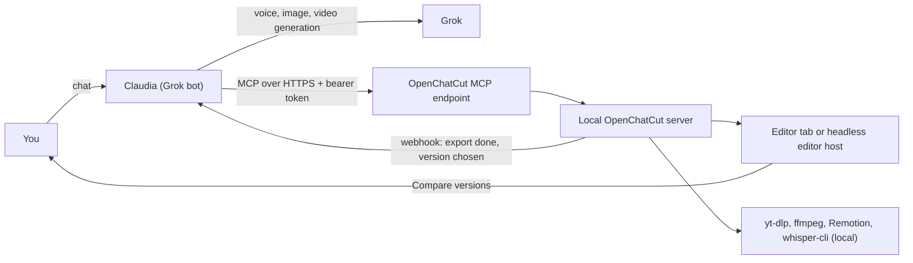

# Plan 1: Claudia's music-video editor on OpenChatCut

> Approved plan. Task status and the next task to pick live in `docs/plans/PROGRESS.md`, not here.
> Paths are relative to the repo root. If a path here and the code disagree, the code wins: fix this file in the same commit.

## Goal
Make the OpenChatCut fork Claudia's editing limb. Every feature goes into the real UI and is also exposed as an MCP tool. The editor itself calls no paid AI APIs (its chat uses free models through DeepSeek Harness: Plan 3). Media comes from Grok, YouTube/Vimeo/Bilibili and real photos, and a compare-and-choose view shows edit versions side by side. An end-to-end export test and verified screenshots prove it works.

## Where things stand
- The OpenChatCut fork on branch `cursor/video-editor-mvp-d191` serves on port 5199. The dev server crashed once because Node ran out of heap memory.
- OpenChatCut already has these, so we reuse them instead of rebuilding:
  - multi-track timeline with Premiere-style tools and shortcuts (V, B, N, U, P, Q/W, I/O, J/K/L)
  - keyframes with easing that render the same in preview and export
  - 22 caption styles with word-level karaoke
  - local whisper-cli transcription
  - 4K export (H.264, VP8, ProRes)
  - multiple sequences per project
  - an MCP server at `/api/external-mcp/mcp` (bearer token, ~124 edit tools)
- Not done yet:
  - Spanish covers about 100 of the 2,520 UI strings that `npm run verify:i18n` counts.
  - No end-to-end export has been verified.
  - The good screenshots so far show only the dashboard, not the editor.
- Done: the Phase 0 cleanup (leftovers of the first attempt and the five orphan components are deleted).

## Decisions
- Keep OpenChatCut as the base. Every feature ships as UI + MCP tool + `*.verify.ts` test and is built on an existing system. The orphan components were deleted, not wired.
- Claudia decides, the editor executes. The editor makes no LLM, image, voice or video API calls: Grok generates, the editor imports, edits and renders.
  - Amended on 2026-10-24 by Plan 3 (`docs/plans/03-deepseek-harness.md`): the built-in chat stays and may use free models, only through the local DeepSeek Harness gateway or a local Ollama/LM Studio. Image, voice, video and music generation stay off.
- Referenced repos:
  - EffectCraft: MIT/Apache, pure Rust, alpha since Oct 1, 2026, with MCP and headless render. Optional titles sidecar in the last phase only.
  - open-edit (VEED): ideas only. Its key features need a VEED login or fal credits.
  - REA: not used on Premiere Pro, because Adobe's license forbids reverse engineering. We match Premiere through its public UX conventions, the same clean-room rule EffectCraft follows.
  - nodecode and AVE: reference only.

## Architecture



## Phase 0 - Clean slate and stable runtime
- Delete leftovers (done):
  - `capture-*.ts`, the `screenshots*/` folders (including `page.html`)
  - `PHASE_3_4_COMPLETE.md`, `STATUS.md`, `FEATURES.md`, `IMPLEMENTATION_PLAN.md`
  - the first MVP's `Dockerfile.backend`, `Dockerfile.frontend` and `docker-compose.yml`
  - `renders/`, `uploads/`, `projects/` and `src/i18n.ts`
  - the five orphan components
- Fix the heap limit in `scripts/dev-profile.mjs` (`runVite`, around line 269): spawn Vite with `--max-old-space-size`, default 6144, overridable with `OPENCHATCUT_DEV_HEAP_MB`. Dev mode stays the runtime because the API routes are Vite middleware and don't run under `vite preview`.
- Add `npm run start:claudia`, which loads a gitignored `.env.claudia`: `OPENCHATCUT_MCP_TOKEN`, `OPENCHATCUT_PROVIDERS=off`, `OPENCHATCUT_ALLOWED_HOSTS`, `PREFERRED_TRANSCRIPTION_PROVIDER=local`.
- Rewrite the README in Spanish: what it is, how to run it, how to connect Claudia, the AGPL v3 note.

## Phase 1 - Claudia's limb
- Switch to turn off all external providers: `OPENCHATCUT_PROVIDERS=off`.
  - Amended by Plan 3: the LLM proxy stays open for DeepSeek Harness, Ollama and LM Studio only, and the chat panel and the dashboard model-setup card stay. HQ-3 blocks the other model providers; P1-1 and P1-2 cover the rest of this list.
  - Server: one middleware in `server/plugins/index.ts` returns 403 `providers_disabled` for the LLM proxy, image/video/voice/music/sound generation, stock search and Firecrawl, the AssemblyAI proxy, e2b and upload-post.
  - Client: hide the chat panel (`src/components/chat/ChatPanel.tsx`), the dashboard model-setup card in `src/components/dashboard/DashboardViews.tsx`, the provider panes in Settings, and the generation menus.
  - MCP: `externalToolSchemas()` in `src/agent/external-tool-schemas.ts` drops generation and stock tools.
- Connection kit:
  - The token comes from env, so it stays stable.
  - `allowedHosts` in `config/vite.config.ts` also accepts hosts from `OPENCHATCUT_ALLOWED_HOSTS`, so a Cloudflare Tunnel or Tailscale Funnel domain works.
  - A "Conectar Claudia" card in `src/components/settings/McpGuide.tsx` shows the URL, the token and this Agent SDK snippet (plus a note to add the domain to `hosting.egressDomains`):

```ts
// Claudia: bot/mcp-connections/openchatcut.ts
export default defineConnection({
  url: process.env.OPENCHATCUT_MCP_URL!, // https://editor.<domain>/api/external-mcp/mcp
  headers: { Authorization: `Bearer ${process.env.OPENCHATCUT_MCP_TOKEN}` },
  advertiseTools: true,
});
```

  - `npm run editor-host` keeps a headless Chromium editor tab open. Export and frame tools only work while a tab is registered with the MCP bridge.
  - Optional webhook (`OPENCHATCUT_WEBHOOK_URL` plus an HMAC secret) for `export.completed`, `export.failed`, `import.completed` and `variant.chosen`. Polling with `track_export` keeps working.
- New skill `src/agent/skills/videoclip-musical/SKILL.md`, loaded with `load_skill`. Workflow:
  1. Song to lyrics with word timings (local whisper, or your lyrics aligned to the audio).
  2. Beats (after Plan 2: listen to the song with `listen_to_song`).
  3. Visuals per lyric line.
  4. Ken Burns on stills, karaoke captions.
  5. 2-3 versions with previews.
  6. Your pick, then the final export and `verify_export`.

## Phase 2 - Wire the features into the real editor
- **Ken Burns**
  - `src/editor/kenBurns.ts` generates scale/x/y keyframes: zoom in, zoom out, pan in four directions, and a seeded random move. They are written with `setItemKeyframe` as a single undo step.
  - UI: a section in `AnimationTab` (`src/components/inspector/InspectorContent.tsx`) that appears when every selected clip is `kind === 'image'`, plus a context-menu action.
  - MCP: `apply_ken_burns`.
  - Preview and export both read keyframes through `ClipWrapper` and `appearanceAt`, so the motion appears in both without new render code.
- **Captions**
  - Add `verso` and `coro` styles to `CAPTION_STYLES` in `src/captions/styles.ts`.
  - New `src/captions/ass.ts` turns Dialogue lines with `\k`/`\kf`/`\ko` tags into `TranscriptWord[]`. New `src/captions/vtt.ts` handles VTT. SRT reuses `parseSrt` from `src/captions/srt.ts`.
  - UI: "Importar subtítulos (SRT/ASS/VTT)" and a "Videoclip" preset group in `src/captions/CaptionStyleMenu.tsx` and `src/captions/CaptionsPanel.tsx`.
  - MCP: `import_subtitles`.
- **Duplicates**
  - `POST /api/media-duplicates` takes frames with ffmpeg at 10%, 50% and 90% and compares 64-bit dHashes against a Hamming threshold, cached by content hash. It also flags source ranges reused on the timeline.
  - UI: "Detectar duplicados" in the media pool menu (`src/media/MediaPoolToolbar.tsx`) opens a dialog with thumbnails, jump-to-clip and remove.
  - MCP: `find_duplicate_media`.
- **Export**
  - Add `h265` to `ExportVideoCodec` (`src/export/useExportDialogModel.ts`), to `EXPORT_MEDIA` (`server/plugins/export-plan.ts`, mp4 with the `hvc1` tag) and to `remotion/render.mjs`.
  - HEVC always renders on the server. If Remotion's encoder lacks HEVC, fall back to an ffmpeg x265 transcode.
  - Presets "YouTube 1080p H.264" and "Videoclip 4K HEVC" in the export dialog (`src/export/ExportDialog.tsx`). The MCP export schemas accept `h265`.
- **Countdown**
  - A shared `formatTimecode(frame, total, fps, mode)` in `src/components/timeline/timelineUtil.ts`, used by `src/components/timeline/TimelineToolbar.tsx` (around line 206) and `src/components/timeline/usePlayheadPaint.ts` (around lines 149 and 156).
  - Clicking the timecode switches between elapsed and remaining time (`-00:01:23:10`). The choice is saved in localStorage.
- **Premiere shortcut preset** in `src/shortcuts/ShortcutsDialog.tsx`: C cuchilla, Y deslizar, R ajuste de velocidad, B/N ripple/rolling, on top of the existing J/K/L, I/O, Q/W, V and P.

## Phase 3 - Media acquisition
- **yt-dlp**: `scripts/sync-yt-dlp.mjs` downloads a pinned release and checks its SHA-256, the same way `scripts/sync-whisper-cli.mjs` works. The binary goes to `vendor/yt-dlp/<platform>/`, outside `public/`, and the script runs in `predev`.
- **Route**: `POST /api/import-platform` in a new `server/plugins/platform-import.ts`.
  - Allowlist: youtube.com, youtu.be, vimeo.com, bilibili.com, b23.tv.
  - Highest quality with `-f "bv*+ba/b" -S "res,fps"`. `--download-sections` grabs only the part you need.
  - Progress runs as a generation job, so `track_progress` and the media pool progress row work.
  - The existing ffprobe gate and `normalize-media`/preview proxy keep editing smooth. Export uses the full-resolution master.
  - Optional `YTDLP_COOKIES_FILE`: Bilibili needs a logged-in account for 1080p and above, including 4K.
- **Credits**
  - Title, uploader, page URL and license are stored on the asset.
  - `download_media` gets the same optional `source` fields for Claudia's real photos, plus the lyric line and search query.
  - All of it appears in a "Créditos" list that exports as `creditos.txt`.
- **UI**: "Importar desde enlace" in the media pool. A direct file URL uses the existing `/api/import-url` (`server/plugins/upload-routes.ts`); a platform page uses the new route.
- **MCP**: `import_from_platform`.

## Phase 4 - Compare versions and choose
- A version is a sibling sequence in `ProjectDoc.timelines[]`, created with `duplicateTimeline` (`src/components/timeline/TimelineTabs.tsx`) and tagged `variant: { groupId, label, note, status }`.
- MCP tools:
  - `create_variants` makes 2-4 copies. Claudia then edits each one with the existing timeline-targeted tools.
  - `render_variant_previews` renders 480p previews on the server.
  - `get_variant_choice` long-polls for up to 45 s.
  - `choose_variant` records a choice you made in chat.
- "Comparar versiones" dialog: a 2x2 grid of synced players with Claudia's notes. "Elegir esta versión" makes that the active sequence, keeps the others marked "descartada", and fires `variant.chosen`.

## Phase 5 - Genuine Spanish
- Copy the 19 English modules in `src/i18n/dict/en/` into `src/i18n/dict/es/*.ts` (about 2,520 strings) and translate them. A glossary keeps the terms consistent with Premiere Pro's Spanish UI (Línea de tiempo, Secuencia, Fotograma clave, Cuchilla, Controles de efectos). Placeholders such as `{n}` are kept intact.
- Extend `scripts/check-i18n.mjs` so `verify:i18n` requires 100% coverage and matching placeholders.
- A Playwright text scan finds no Chinese and no untranslated English on the dashboard, editor shell, timeline, inspector, media pool, captions, export and settings.

## Phase 6 - End-to-end proof and honest report
- `e2e/claudia-flow.e2e.ts` (`npm run e2e:claudia`) calls the real MCP endpoint the way Claudia would, while Playwright at 1600x1000 keeps the editor open.
  - Media: your own files, kept outside the repo in the folder named by `CLAUDIA_E2E_MEDIA_DIR` (default `~/corteo-media`): the 3:28 song WAV, a 1280x720 clip and a photo. The test fails with a clear message if a file is missing.
  - Edit: place the clips, apply Ken Burns to the photo, import `verso` captions from an ASS file, make two versions, pick one.
  - Export 8 s at 1080p H.264 and 3 s at 4K HEVC.
  - ffprobe must report 1920x1080, h264, 8.00 s ±1 frame with AAC audio, and 3840x2160 hevc.
  - Two exported frames from the photo segment must differ, which proves Ken Burns moves in the export.
- Screenshots at device scale 1, so each is truly 1600x1000. They are taken only after network idle, once the timecode, timeline items and a painted preview are present:
  - editor with media and the Ken Burns inspector
  - caption menu with karaoke in the preview
  - duplicates dialog
  - export dialog set to 4K HEVC
  - countdown timecode
  - "Comparar versiones"
  - "Conectar Claudia"
- Each screenshot must be over 100 KB and pass a pixel-variance check, so blank or loading screens fail. They are saved to `test-results/claudia/` (gitignored).
- Run the affected `*.verify.ts` files and `verify:server-tool-catalog`, after regenerating `assets/agent/openchatcut-tool-schemas.json` for the new tools.
- Report pass or fail per item, with output paths and no rounding up.

## Phase 7 (optional) - EffectCraft titles sidecar
- Pin `effectcraft-cli`. A new MCP tool `render_motion_title` renders a templated `.ecproj` (plain JSON) to ProRes 4444 with alpha and imports it as an overlay. Off by default.

## Assumptions and risks
- Claudia is the Grok Agent SDK bot that sends these requests, and she connects over HTTPS MCP. If she runs somewhere else, only the connection config changes.
- "No external APIs" means no keyed AI or paid providers inside the editor. yt-dlp downloads and Claudia's own web search stay, because you asked for them.
- yt-dlp breaks when platforms change, so the binary is pinned and `npm run sync:yt-dlp -- --update` refreshes it.
- You hold the rights to downloaded media and photos. The editor records their sources.
- 4K HEVC encoding is slow on a laptop CPU, so the E2E test renders short ranges.
