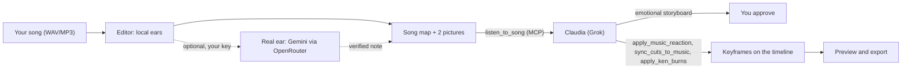

# Plan 2: Claudia listens to the song (song map, real ear, music-driven motion)

> Approved plan. Task status and the next task to pick live in `docs/plans/PROGRESS.md`, not here.
> Paths are relative to the repo root. If a path here and the code disagree, the code wins: fix this file in the same commit.
> It slots in after Plan 1 Phase 1 (connecting Claudia) and before Ken Burns and captions in Phase 2, which then use the map.

## Goal
Make the editor Claudia's ears. Local analysis gives a song map (tempo, beats, energy, sections with mood, drops, key, lyrics) plus pictures Grok can see. An optional audio-model relay, adapted from [claude-audio-listening-skill](https://github.com/uset82/claude-audio-listening-skill), can listen too. New generators turn the map into motion on the timeline (pulse, punch-in, shake, flash, breathing, Ken Burns to the rhythm, beating captions). Each piece is available both as an MCP tool and in the UI.

## Why this works
- Grok can't hear. xAI's chat API takes text and images, and its speech-to-text returns words only. So the editor becomes Claudia's ears: she reads what they report and looks at pictures of the sound, which Grok can see.
- This keeps the two channels of claude-audio-listening-skill: a local "picture" (spectrogram, waveform, loudness) and an optional "relay" to an audio-capable model, plus its check that the model really received the audio.
- Half of it already exists:
  - Beat This finds beats, downbeats and BPM, and CLAP tags 8 moods, 8 genres and 8 instruments, both on-device.
  - Sections come from energy changes.
  - `sync_cuts_to_music` and `sync_images_to_music` already cut and place photos on the beat.
- Missing:
  - running without a browser tab
  - mood per section
  - drops, accents, bass and key
  - the pictures
  - the relay
  - motion, not just cuts, that follows the music

## Flow

## Part A - Local ears (free, nothing leaves your PC)
- **Server runner**
  - Move the inference cores out of `desktop/native-rhythm-worker.ts` and `desktop/native-clap-worker.ts` into shared modules. They already use `onnxruntime-node`; only `process.parentPort` is Electron-specific.
  - Run them in a `worker_threads` worker from a new `server/music-listen/` plugin, with ffmpeg decoding to 22.05 kHz mono.
  - Write results to the same cache key as `src/audio/intelligence/store.ts`, so the media-card badge shows them.
  - Make `analyze_music` and `inspect_music` server-direct in `src/agent/external-tool-policy.ts` and the offline executor (`server/external-agent/offline-executor.ts`), so Claudia can use them with no tab open.
- **New measurements** in `src/audio/listen/` (pure DSP, shared by the server and the tests):
  - energy every 50 ms, plus bass, mid and brightness bands
  - onsets and accent strength, from the onset envelope extracted out of `src/audio/beats.ts`. Its beat tracker is the fallback when the model packs are missing.
  - moments: drop, break, build start, stop, vocals in and out
  - key and mode from chroma
  - EBU R128 loudness (I, LRA, true peak) and the short-term curve from ffmpeg `ebur128`, run with `-hide_banner -nostats`. `-v error` hides the summary, the trap the reference project documents.
- **Mood per section**
  - `src/audio/intelligence/clapClient.ts` already embeds 10-second windows. Score each section against the prototypes instead of only the whole song. Embeddings still never reach the model.
  - A one-off `scripts/build-clap-prototypes.mjs` uses the CLAP text encoder to add labels that fit your music, shown in Spanish:
    - moods: nostalgic, hopeful, festive, sensual, spiritual
    - genres: cumbia, salsa, bolero, reggaeton, huayno, flamenco, Latin rock
- **Lyrics**: lines come from the song's local whisper transcript. Repeated lines are marked as chorus candidates and attached to their section. Lyrics you provide win.
- **Pictures** (`server/music-listen/pictures.ts`):
  - A "Mapa" PNG drawn as SVG and rasterized with `sharp`, which is already installed (pin it as a direct dependency). It shows the waveform, energy and bass curves, section bands with role and mood, downbeat ticks, drops, lyric lines and an mm:ss axis.
  - A spectrogram from ffmpeg `showspectrumpic` (log frequency, legend), like `look_at_audio.py` in the reference project.
- **MCP tool `listen_to_song`** (read-only, server-direct)
  - Input: `itemId` or `assetId`, an optional range, `pictures` (default on) and `relay` (default off).
  - Output: a Spanish summary, compact JSON (sections, moments, 1-second curves) and a `songMapRef`. The text stays under the 16,000-character MCP limit.
  - Both PNGs come back as MCP image blocks through the `__images` path that `src/agent/tools/frames-tool.ts` already uses.
  - Full-resolution data stays on the server for the generators.

## Part B - Real ear (optional, off by default)
- **Setup**
  - `server/music-listen/relay.ts`, ported from `describe_audio.py` in the reference project.
  - It runs only if `.env.claudia` sets `OPENCHATCUT_LISTEN_RELAY=openrouter` and `OPENROUTER_API_KEY`. A $1 spend cap is plenty.
  - Default model `google/gemini-3.8-flash`. `LISTEN_RELAY_MODEL` and an optional cross-check model override it.
- **Request**
  - The song is shrunk to 64 kbps mono mp3. A 3:28 song becomes about 1.6 MB, one request.
  - The prompt asks, in Spanish, for timbre, vocal emotion, arrangement and the emotional arc with timestamps, with lyrics only as short quotes.
- **Proof it heard**
  - `audio_tokens > 0` marks the note "verificado".
  - Otherwise it is "sin verificar". The editor then checks the relay's timestamps against the local sections (within 3 s) and its quotes against the whisper words, and reports what matched.
  - The provider and token counts are saved with the note.
- **Limits**
  - Cached per song version and model, and never automatic. Well under a cent per song.
  - It is the only paid AI call the editor makes, and only when you turn it on. (The chat's free models through DeepSeek Harness, Plan 3, are the other AI call.) `OPENCHATCUT_PROVIDERS=off` still blocks every other cloud service.
  - When it runs, your song goes to OpenRouter and the model provider.

## Part C - Motion that follows the music
- **Animatable filters**
  - Add `brightness`, `contrast`, `saturate` and `blur` to `KeyframeProp` in `src/editor/clipTypes.ts` and to `src/editor/keyframeRegistry.ts`.
  - Sample them in `appearanceAt` (`src/editor/clipFade.ts`, around lines 60-69) and in the background fill in `src/editor/TimelineMediaLayer.tsx` (around line 275), and accept them in `edit_item`. Preview and export both read `appearanceAt`, so they stay identical.
  - Switch `sampleKeyframes` in `src/editor/keyframes.ts` to binary search, because beat reactions add hundreds of keyframes.
- **Generators** in `src/editor/musicReactions.ts` (pure functions)
  - Map song time through the music clip's trim and speed to clip-local frames, using the same mapping as `src/agent/tools/music-intelligence-plan.ts`.
  - Emit `setKeyframe` actions scaled by local energy, seeded, and capped per clip.
  - Reactions:
    - `pulso`: a scale bump on beats or downbeats
    - `golpe`: a punch-in zoom at drops and section starts
    - `temblor`: a decaying x/y/rotation shake on strong accents
    - `destello`: a brightness flash on downbeats or drops
    - `respirar`: saturation, blur or scale follow the energy curve
    - `ken-burns-al-ritmo`: Plan 1's Ken Burns, with speed per section set by energy
    - captions `latido`: a new motion in `src/captions/captionMotion.ts` that pulses the active line on beats
  - Each clip keeps `musicReactions[]` metadata (reaction, props, timing, intensity, `songMapRef`), so a reaction can be listed, removed, or regenerated after re-analysis.
- **MCP tools**, server-direct like `edit_item`, using the existing plan-then-apply pattern:
  - `music_reaction_plan` (read-only): keyframe counts and sample frames.
  - `apply_music_reaction` and `clear_music_reaction`: one undo step via `commands.batch`. They reject a stale `songMapRef` and skip locked tracks.
- **UI**: "Reaccionar a la música" in `AnimationTab` (`src/components/inspector/InspectorContent.tsx`):
  - reaction chips
  - timing: Pulsos, Compases, Acentos, Caídas, Secciones, Energía
  - an Intensidad slider, plus Aplicar and Quitar
  - a small energy strip of the song under the clip

## Part D - See the song
- A "Mapa musical" overlay under the music clip in the timeline, toggled from `src/components/timeline/TimelineToolbar.tsx`. It shows section bands with mood, downbeat ticks and drops.
- A "Mapa de la canción" dialog, opened from the media-card badge (`src/audio/intelligence/MusicAnalysisBadge.tsx`). It shows:
  - the map image, tempo, key and loudness
  - the sections with moods and lyric lines
  - the real-ear note with an "Escuchado de verdad" or "Sin verificar" badge
  - an "Escuchar con oído real" button when the relay is set up

## Part E - Claudia's skill
- `src/agent/skills/escuchar-cancion/SKILL.md`, adapted from the reference SKILL.md:
  1. Call `listen_to_song` and look at both pictures.
  2. With the relay, treat its note as a report:
     - Keep what the ear said apart from what she concluded.
     - Check physical claims on the map.
     - Treat transcribed lyrics as guesses; your lyrics win.
     - Say when a note is unverified.
  3. Write a "partitura emocional": for each section, a feeling, an intensity from 0 to 10 and the visual intent (motion, cut pace, look, caption style), quoting the lyric lines.
  4. Map it to tools with the skill's table:
     - quiet melancholic intro: slow Ken Burns, cuts only at section changes, a cool look
     - build: a growing `pulso`
     - drop or peak: `golpe` plus `destello` on downbeats, cuts on the beat, `temblor` on accents
     - break: `respirar`
     - outro: zoom out and fade
  5. Show you the partitura in Spanish before editing. Then apply it and make a "tranquila" and an "intensa" version for "Comparar versiones" (Plan 1 Phase 4).
- Add an MCP prompt `escuchar-y-editar-cancion` in `server/external-agent/mcp-prompts.ts`. Step 2 of the `videoclip-musical` skill becomes "listen to the song".

## Verification
- **Synthetic-audio tests**
  - A 120 BPM click gives onsets every 500 ms (within 10 ms).
  - A bass burst lights up the bass band.
  - A silent gap is detected as a stop.
  - An A-minor triad reads as A minor.
  - A quiet-to-loud jump is detected as a drop.
  - The `listen_to_song` result stays under the MCP limit.
- **Generator tests**
  - Keyframes land on beat frames after trim and speed.
  - The caps hold, and one batch means one undo step.
  - Filter keyframes sample identically through `appearanceAt`.
- **Relay test** against a local mock OpenRouter: request shape, the `audio_tokens` rule, caching, and no call when the relay is off.
- **End-to-end test** with the 3:28 song from `CLAUDIA_E2E_MEDIA_DIR` (see Plan 1 Phase 6) through the real MCP endpoint:
  - `listen_to_song` returns the map and two non-blank PNGs.
  - Apply `pulso` and `golpe`, then export 8 s at 1080p.
  - A frame on a beat and a frame between beats must differ in scale, which proves the motion follows the beat in the export.
  - Take screenshots of the dialog and the inspector section into `test-results/claudia/`.

## Fit and risks
- Beat This and CLAP need their model packs installed once (Settings, local models): about 117 MB, MIT and Apache-2.0 licensed. Without them, `listen_to_song` still returns the measurements, the fallback beats and the pictures. Tests must not depend on the packs.
- CLAP moods are coarse labels. The nuance comes from the lyrics, Claudia's reading, and the relay if you turn it on.
- Audio-model names change every few weeks, so the model is a setting, not code.
