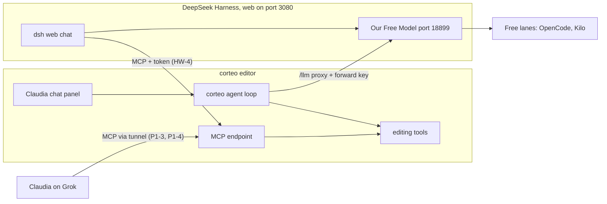

# Plan 3: free models for Claudia's chat through DeepSeek Harness

> Approved plan (2026-10-24). Task status lives in `docs/plans/PROGRESS.md`: the "Harness track · Qoder (HQ)" and "Harness track · WorkBuddy (HW)" sections, and H-9 in the main table. The task cards are in this file.
> Paths are relative to the repo root. If a path here and the code disagree, the code wins: fix this file in the same commit.

## Goal
The chat built into corteo (the Claudia panel) runs on free models served by [DeepSeek Harness](https://github.com/deepseek-ai/deepseek-harness) (`dsh`) with the [Our Free Model](https://github.com/Ebony-Vinyl/dsh-our-free-model) plugin, and Claudia can talk to every model the plugin offers. With `OPENCHATCUT_PROVIDERS=off` the paid and account-based brains (Codex, Copilot, Claude Code, xAI, the paid API vendors) disappear. DeepSeek Harness's own web chat can also edit corteo over MCP. Claudia on Grok keeps driving corteo over MCP as in Plan 1.

## Decisions
- **corteo keeps its own agent loop; DeepSeek Harness replaces the paid models.**
  - The loop in `server/agent-runs/` runs the ~120 editing tools, approvals, undo and context compaction. None of that changes.
  - The plugin serves an OpenAI-compatible port on `127.0.0.1:18899`, protected by its own key. corteo reaches it like any `openai-compatible` provider (Ollama uses the same type), through the existing `/llm` proxy in `server/plugins/llm-proxy.ts`.
- **The old brains disappear from the UI.** With `OPENCHATCUT_PROVIDERS=off`:
  - Settings and the Model menu show only DeepSeek Harness, plus local Ollama and LM Studio (also free).
  - Codex, Copilot, Claude Code, xAI and the paid API vendors are hidden; their routes answer 403 `providers_disabled`, and server runs that would use them are refused.
- **Every harness model is in the Model menu.** Today the menu shows one saved model per provider (`src/agent/model-selection.ts`). The harness models are discovered from `/v1/models`, one menu entry each.
- **DeepSeek Harness gets corteo as an MCP server**, so its web chat (`127.0.0.1:3080`) can edit the timeline.
- **Not replacing the editor loop with DeepSeek Harness's own agent** (`dsh --profile acp`): that would rebuild the chat on a developer-preview harness with no editing gain. It can be revisited later.
- **Changes to the earlier plans** (already applied to the files):
  - `AGENTS.md` rule 1: no paid APIs; the built-in chat may use free models only through the local DeepSeek Harness gateway or local Ollama/LM Studio.
  - P1-1 and P1-2 keep blocking generation, stock and cloud transcription. Blocking the chat's model providers moves to HQ-3, and P1-1 waits for H-9 so `server/plugins/providers-off.ts` is not created twice.
  - Claudia on Grok over MCP (P0-3, P1-3, P1-4) is unchanged.

## Architecture



## Guardrails
These go into both kickoffs. Breaking one is a blocker, not a judgment call.
- **Install the plugin from its git tag only.** Tag `v2.5.9`, commit `25ab765d6bb860779dbd8c53062953524f3cac09`. The npm package `dsh-our-free-model` is a modified third-party copy: never install it.
- **`distribution: managed`.** It turns off the plugin's self-upgrade, its remote announcements and its hot reload, so the code that runs is the code we pinned.
- **Pin DeepSeek Harness.** `@deepseek-ai/dsh@0.2.1-rc.2` (npm `latest` on 2026-10-24); the plugin's peer range accepts it (dsh checks with prereleases included). If it fails with the plugin, fall back to `0.1.7-rc.2`, the newest version the plugin was tested on, and record the decision.
- **Only the anonymous free lanes, plus optional bring-your-own keys.** Never log into the plugin's ten account channels (LobsterAI, Qoder, TRAE, Cline, Loomy, Raccoon, MiniMax, ZCode, Gemini…) or its EAC channel. Pooling accounts and claiming credits likely breaks those services' terms, and one of them is Qoder: Carlos could lose the IDE he uses.
- **The free lanes are not private.** Kilo says prompts may be logged. The OpenCode lane works by presenting OpenCode's client fingerprint. Either quota can vanish at any time. Lyrics, file names and frames sent to these lanes may be seen by third parties.
- **Loopback only.** The forward port stays on `127.0.0.1`; never turn on the plugin's LAN forward or its channel gateway relay.
- **Never commit the forward key or the MCP token**, and never print the full key in logs or reports (mask it).

## Names, paths and ports

| What | Value |
|---|---|
| DeepSeek Harness | npm `@deepseek-ai/dsh@0.2.1-rc.2`, installed in `~/.corteo-harness/runtime/` (not global, not `npx` at every start) |
| Harness home | `DSH_HOME=~/.corteo-harness`, one for the whole machine. Profiles live in `$DSH_HOME/profiles/`; we use the `web` profile |
| Plugin source | `~/.corteo-harness/vendor/dsh-our-free-model`, cloned at the tag. `dsh plugin add` links it (`link:` in the profile's `package.json`), so the clone must stay |
| Plugin settings | `~/.corteo-harness/our-free-model/settings.json` (mode 0600): `distribution`, `forward`, `forwardKey`. The plugin merges its top-level keys over its defaults, so `forward` must be written whole |
| Web UI | `dsh web --no-open --host 127.0.0.1 --port 3080` → http://127.0.0.1:3080 (from Windows: http://localhost:3080) |
| Forward port | `127.0.0.1:18899`. If taken, the plugin binds the next free port up to 18909, then a random one; the doctor finds the real one |
| Forward endpoints | `GET /v1/models`, `POST /v1/chat/completions`, `/v1/responses`, `/v1/messages`; `Authorization: Bearer <forwardKey>`, 401 without it |
| corteo dev servers | Carlos `~/corteo` on 5199, WorkBuddy `~/corteo-workbuddy` on 5201, Qoder `~/corteo-qoder` on 5202 (`npm run dev -- --port N`) |
| corteo MCP | `http://localhost:<port>/api/external-mcp/mcp`, bearer token |
| MCP token | `OPENCHATCUT_MCP_TOKEN` if set; otherwise `~/.openchatcut/dev-profiles/<profileId>/mcp-token`, where `<profileId>` is in `$(git -C <checkout> rev-parse --absolute-git-dir)/openchatcut-dev-profile.json`. Each worktree has its own profile and token |
| Tool schemas for tests | `assets/agent/openchatcut-tool-schemas.json`: `{version, edit[124], ask[23]}`, each `{name, description, input_schema}` |

## Parallel work
Two agents work at the same time, each in its own git worktree and branch, created from `github/main` after this plan is published:

| Track | Agent | Checkout | Branch | corteo port | Tasks |
|---|---|---|---|---|---|
| Editor side | Qoder | `~/corteo-qoder` | `harness-qoder` | 5202 | HQ-1 to HQ-5 |
| Harness side | WorkBuddy | `~/corteo-workbuddy` | `harness-workbuddy` | 5201 | HW-1 to HW-5 |

- **File ownership.** Qoder owns `src/`, `shared/`, `server/` and `config/vite.config.ts`. WorkBuddy owns `scripts/harness/`, `config/harness.json`, `config/harness/` and `docs/harness.md`. Both may add their own scripts and verifies to `package.json` and `.gitignore`. Neither edits `README.md` (H-9 does) or the other track's PROGRESS section.
- **PROGRESS.** Each agent updates only its own section in `docs/plans/PROGRESS.md`: status table, decisions, blockers (and, for WorkBuddy, the model results).
- **Expected conflicts at H-9:** the `test:serial` line in `package.json`, `.gitignore`, and the two PROGRESS sections. H-9 resolves them.
- **WSL.** Every git, npm, node, npx and dsh command runs inside WSL, in the Linux checkout. An IDE that runs on Windows wraps each command: `wsl.exe -e bash -lc 'source ~/.nvm/nvm.sh && cd ~/corteo-workbuddy && <command>'` (the `source` is needed because Ubuntu's `.bashrc` stops early in non-interactive shells, before the nvm lines). Never run git or npm from Windows on a `\\wsl$\…` path: Windows git drops the executable bit of `cli/occ.mjs` and `dev-with-mcp.sh`, and a worktree created that way records a Windows path that Linux git can't read.
- **Memory and disk.** Three corteo dev servers plus the harness need about 12–16 GB of RAM in WSL; with less, Carlos stops his own `corteo` while the agents work. Each worktree has its own `node_modules` (about 4 GB, more as Vite's cache grows; `ONNXRUNTIME_NODE_INSTALL=skip npm install` saves about 0.6 GB without an NVIDIA GPU).

### Setting up the worktrees (Carlos, in WSL, after this plan is on GitHub)

```bash
cd ~/corteo && git fetch origin && git push github origin/cursor/video-editor-mvp-d191:main
git fetch github
git worktree add ~/corteo-qoder -b harness-qoder github/main
git worktree add ~/corteo-workbuddy -b harness-workbuddy github/main
cd ~/corteo-qoder && npm install
cd ~/corteo-workbuddy && npm install
```

If a worktree was already created from Windows (through `\\wsl$`), remove it and create it again from WSL before the commands above: `rm -rf ~/corteo-workbuddy && cd ~/corteo && git worktree prune && git branch -D harness-workbuddy` (only while that branch has no commits of its own).

## Manual setup
For Qoder when it reaches HQ-5 and no harness runs yet, or for Carlos before HW-1 and HW-2 are done. HW-1 and HW-2 automate exactly this. In WSL:

```bash
export DSH_HOME=~/.corteo-harness
npm install -g pnpm@10                      # once: dsh's plugin command runs pnpm
npm install --prefix "$DSH_HOME/runtime" @deepseek-ai/dsh@0.2.1-rc.2
git clone --depth 1 --branch v2.5.9 https://github.com/Ebony-Vinyl/dsh-our-free-model.git "$DSH_HOME/vendor/dsh-our-free-model"
git -C "$DSH_HOME/vendor/dsh-our-free-model" rev-parse HEAD   # must print 25ab765d6bb860779dbd8c53062953524f3cac09
"$DSH_HOME/runtime/node_modules/.bin/dsh" plugin --profile web add "$DSH_HOME/vendor/dsh-our-free-model"
mkdir -p "$DSH_HOME/our-free-model"
F="$DSH_HOME/our-free-model/settings.json"
[ -e "$F" ] || printf '%s\n' '{"distribution":"managed","forward":{"enabled":true,"host":"127.0.0.1","port":18899,"lan":{"enabled":false,"port":0}}}' > "$F"
chmod 600 "$F"
"$DSH_HOME/runtime/node_modules/.bin/dsh" web --no-open --host 127.0.0.1 --port 3080   # in its own terminal; leave it running
```

Then, in another terminal:

```bash
KEY=$(node -p 'require(process.env.HOME + "/.corteo-harness/our-free-model/settings.json").forwardKey')
curl -s -H "Authorization: Bearer $KEY" http://127.0.0.1:18899/v1/models | head -c 600
```

In corteo (after HQ-1): Settings › agent models › DeepSeek Harness, Base URL `http://127.0.0.1:18899/v1`, the key, then the page's test button. If `settings.json` already existed without `distribution` or `forward`, stop dsh, add those two keys by hand (keep the rest), and start it again: a running plugin rewrites the file from memory.

## Task cards
Each card says which files to start from, what to do, when it counts as done, and what to run in addition to the standard loop in `AGENTS.md`. Tests never call the real harness or the network: they use a local stub of the forward port.

### Qoder track: editor side

#### HQ-1 · DeepSeek Harness provider
- Files: `shared/llm-providers.ts`, `server/keystore-names.ts`, `shared/model-capabilities.ts`, `src/components/settings/settingsAgentProviders.ts`, `src/components/settings/vendorIcons.tsx`, `src/components/settings/VisionModelPane.tsx` (`PROVIDER_LABELS` is a `Record<LlmProvider, string>`, so `tsc` fails until `dsh` is in it), the `es` and `en` dictionaries.
- Do:
  - Append a preset to `LLM_PROVIDER_PRESETS`: `{ id: 'dsh', label: 'DeepSeek Harness', protocol: 'openai-compatible', baseUrl: 'http://127.0.0.1:18899/v1', defaultModel: <the plugin's default group> }`. Append, never prepend: `LLM_PROVIDER_PRESETS[0]` is the fallback for unknown ids. The plugin's default fallback group is `combo:recommended-free` in its settings; if a harness is running, check that exact id in its `/v1/models`, otherwise use it as is (H-9 sets the final default from HW-3).
  - `dsh` is not a local provider: the forward port demands a key, and prompts leave the machine. Don't add it to `isLocalLlmProvider`. The generic probe (`llmProbe` in `server/key-probes.ts`) then requires the key and calls `<base>/models` with it, which is what we want.
  - Add `LLM_DSH_API_KEY`, `LLM_DSH_BASE_URL` and `LLM_DSH_MODEL` to `KEY_NAMES`. The base URL and model become non-secret automatically through `llmProviderConfigNames`; the key stays secret.
  - Settings page: the pages are built from the presets (`key: llm/<id>`). Show the `dsh` page first, with the DeepSeek icon (`deepseekSvg` in `vendorIcons.tsx`) and a Spanish help line: start the harness with `npm run harness`, then `npm run harness:doctor` prints the URL and the key to paste here.
  - Fallback limits for `dsh` models missing from the capability catalog: 128k context and 16k output (estimates; a settings override still wins). Today unknown models get 409,600 tokens of context (`UNKNOWN_CONTEXT_TOKENS`), which would delay compaction until the free lanes overflow.
  - The probe's results are Chinese keys that `settingsVendorPane.tsx` translates with `t()`. Add the missing `es` entries for the messages this page can show (success, 401, unreachable), so the wrong-key case reads in Spanish.
- Done when: Settings shows "DeepSeek Harness" first; the page's test button (`测试并读取模型`) against a stub of the forward port lists its models; with a wrong key it shows a Spanish message; `npx tsc -b` passes.
- Verify: extend `server/key-probes.verify.ts` (a stub `/v1/models` with and without the key) and `shared/model-capabilities.verify.ts` (the 128k/16k fallback); `npm run verify:i18n`. `shared/` changed, so run `npm test` before marking it done.

#### HQ-2 · Every harness model in the Model menu
- Files: `src/agent/model-selection.ts` (+ `src/agent/model-selection.verify.ts`), `src/app/appShell.ts` (+ `src/app/appShell.verify.ts`), `src/components/chat/ComposerModelPicker.tsx`, the dictionaries.
- Do:
  - Discovery: when the `dsh` key is configured, call `POST /api/keys/test` with `{ page: 'llm/dsh', overrides: {} }`; it returns `{ ok, models }`. Run it at app launch from `syncAgentBackends` in `src/app/appShell.ts`, detached like `syncCopilotBackend` so a stopped harness never delays the other models, and again from a refresh button.
  - Menu entries: `apiChoices` makes one choice per provider. For `dsh`, build one choice per discovered model instead (`id: 'dsh:<modelId>'`, `backend: 'api'`, `provider: 'dsh'`, `model: <modelId>`), following the discovered-models pattern of Codex and Copilot. Model ids may contain `:` or `/` (the plugin's groups are `combo:<name>`): look choices up by their whole id, never split them.
  - Keep the saved `LLM_DSH_MODEL` and the last picked `dsh` choice in the list when discovery fails, so the menu doesn't empty while the harness restarts.
  - Picking an entry must reach the run: server runs already honor the requested model (`resolveRunExecution` in `server/agent-runs/execution-input.ts` prefers `input.model`). Check that the client sends it for `dsh` choices.
  - `ComposerModelPicker.tsx`: a refresh button for the DeepSeek Harness group, and a Spanish notice when discovery fails ("DeepSeek Harness no responde. Arráncalo con `npm run harness`.").
  - The empty state "请先在设置中配置一个模型厂商。" (English: "Configure at least one model provider in Settings first.") becomes three steps in Spanish: start the harness (`npm run harness`), get the URL and key (`npm run harness:doctor`), paste them in Settings › DeepSeek Harness. Change the `es` and `en` entries; the key stays.
- Done when: with a stub serving three models, the menu lists three DeepSeek Harness entries; a run started with the second one sends that model to `/llm`; with the stub stopped, the last picked model is still selectable and the notice shows; the refresh button reloads the list.
- Verify: `npx tsx src/agent/model-selection.verify.ts` and `npm run verify:project-store-transport` (runs `appShell.verify.ts`), extended for the above; `npm run verify:components`; `npm run verify:i18n`.

#### HQ-3 · Only DeepSeek Harness under `OPENCHATCUT_PROVIDERS=off`
- Files: new `server/plugins/providers-off.ts` + `server/plugins/providers-off.verify.ts`, `server/plugins/index.ts`, `server/agent-runs/execution-input.ts` (+ `server/agent-runs/executor.verify.ts`), `config/vite.config.ts`, `src/globals.d.ts`, `src/components/settings/settingsAgentProviders.ts`, `src/app/appShell.ts`, `src/agent/model-selection.ts`.
- Do:
  - `providers-off.ts`: read `OPENCHATCUT_PROVIDERS === 'off'` from the process environment. When on, answer 403 `{"error":"providers_disabled"}` for:
    - `/llm` when the provider is not `dsh`, `ollama` or `lmstudio`. Resolve the provider exactly like the proxy does (`llmProviderForRequest` in `server/plugins/llm-proxy.ts`: the `x-openchatcut-provider` header, else the saved `LLM_PROVIDER`). This also blocks `xai-oauth`.
    - `/api/codex`, `/api/copilot`, `/api/claude-code` and `/api/xai-oauth`.
  - Keep the allowed providers and the blocked prefixes in exported lists: P1-1 later adds the generation, stock and cloud-transcription routes to the same file instead of writing a second middleware.
  - Register it in `serverPlugins()` (`server/plugins/index.ts`) right after `requestShapeGatePlugin()`, so it runs before the routes.
  - Server runs: Codex, Claude Code and Copilot server turns don't go through those HTTP routes. With the switch on, `resolveRunExecution` refuses `backend` `codex`, `claude-code` and `copilot`, and any provider outside the allowed three.
  - Client: expose the switch as its own boolean define in `config/vite.config.ts` (for example `__PROVIDERS_OFF__`, declared in `src/globals.d.ts`). Don't add it to `__CONFIGURED_CAPS__`: that object feeds the agent's capability prompt. Then hide every agent vendor page except the three, skip the Codex, Copilot and Claude Code status probes in `syncAgentBackends`, build no choices for those backends, and make sure the "make Codex the active model" fallback there can't fire.
- Done when: with `OPENCHATCUT_PROVIDERS=off npm run dev -- --port 5202`, Settings lists only DeepSeek Harness, Ollama and LM Studio among the agent models, the Model menu shows only their models, each blocked route answers 403 `providers_disabled`, and a server run with backend `codex` is refused. Without the variable, everything behaves as before and the existing tests pass unchanged.
- Verify: the new verify (route list, `/llm` provider check, switch off), `npm run verify:server-runs`, `npm run verify:project-store-transport`, `npm run verify:components`, `npx tsx config/vite.config.verify.ts`. `config/` changed: run `npm test`.

#### HQ-4 · Gateway behaviour tests and Spanish errors
- Files: `server/agent-runs/model.verify.ts`, `server/plugins/llm-proxy.ts` (+ `server/llm-proxy.verify.ts`), `server/proxy.ts`, `src/agent/api-retry.ts`, a stub of the forward port (inside the verify, or a helper next to it).
- Do:
  - Stub the plugin's port: 401 `missing or invalid API key` without the key; `GET /v1/models`; a streaming `POST /v1/chat/completions` that sends `:` heartbeat comment lines, stays silent for a while before the first token (configurable, short in the test), streams `reasoning_content` deltas, and splits one tool call's name and arguments across several chunks.
  - Prove that a server run through `/llm` with provider `dsh` completes a tool round trip: tool call, tool result, final text. Copy the `createServerLanguageModel('ollama', 'gateway-model', 'chat', origin)` test in `server/agent-runs/model.verify.ts`.
  - Errors for `dsh`, in Spanish, where `llmErrorMessage` builds them today: 401 or 403 means copy the key again (`npm run harness:doctor -- --show-key`); 429 means this free model is busy or out of quota, pick another one in the menu.
  - Connection refused never reaches `llmErrorMessage`: `server/proxy.ts` answers 502 `upstream request failed: …` from `upstream.on('error')`. Add an optional per-route message for that case and use it for `dsh`: the harness isn't running, start it with `npm run harness`. `src/agent/api-retry.ts` treats `upstream request failed` and `ECONNREFUSED` as retryable, so check that the user still gets the Spanish message after the retries.
  - Other providers' messages stay as they are.
- Done when: the verifies pass offline and cover every stub behaviour above, and the three messages are in Spanish.
- Verify: `npm run verify:server-runs`, `npx tsx server/llm-proxy.verify.ts`, `npm run verify:affected`.

#### HQ-5 · Real proof from the chat
- Needs a running harness: WorkBuddy's (ask Carlos whether HW-2 is done), or follow "Manual setup".
- Do:
  - In corteo on port 5202, with the dsh key saved, open a test project with at least one video clip (the demo project works).
  - With two different free models picked from the menu, ask Claudia in Spanish for three edits, one message each: a title («Pon el título "Perú" en los primeros tres segundos»), a cut («Corta el primer clip en el segundo 5») and a keyframe («Haz que el título crezca del 100 % al 120 % durante sus tres segundos»).
  - Check each result on the timeline and that each edit is one undo step.
- Done when: the model ids, the result of each edit (worked, partly, failed and why) and the latency per message are recorded in the Qoder section of `PROGRESS.md`. A model that fails is a result, not a blocker; the task is blocked only if no model can complete the cut.
- Verify: screenshots in `test-results/harness/` (never committed).

### WorkBuddy track: harness side

#### HW-1 · Pin and install
- Files: new `config/harness.json`, new `scripts/harness/install.mjs` (+ `scripts/harness/install.verify.mjs`, shared helpers in `scripts/harness/lib.mjs`), `package.json` (`harness:install`; the verify in `test:serial`), `.gitignore` (`!/scripts/harness/`, otherwise the `/scripts/*` rule silently drops the folder).
- Do:
  - `config/harness.json` holds the pins: dsh package and version (`0.2.1-rc.2`, fallback `0.1.7-rc.2`), the plugin repo, tag `v2.5.9` and commit `25ab765d6bb860779dbd8c53062953524f3cac09`, the home (`~/.corteo-harness`), the profile (`web`) and the ports (3080, 18899).
  - `npm run harness:install`:
    1. Checks Node 24 and git, and that `pnpm` is on `PATH` (dsh's `plugin` command runs pnpm). If it's missing, it says so with the fix: `npm install -g pnpm@10`. This card names pnpm, so installing it is allowed.
    2. Installs the pinned dsh in `$DSH_HOME/runtime` (`npm install --prefix`), not globally.
    3. Clones the plugin at the tag into `$DSH_HOME/vendor/dsh-our-free-model` and stops with an error if `git rev-parse HEAD` isn't the pinned commit.
    4. Runs `dsh plugin --profile web add <that folder>` with `DSH_HOME` set.
    5. Writes `distribution: "managed"` into `$DSH_HOME/our-free-model/settings.json`: created with mode 0600 if missing, otherwise read, merged at the top level and written back. Refuse while the harness is running (port 3080 answers): a running plugin rewrites the file from memory.
  - Re-running it changes nothing when everything matches the pins, and says so.
  - Overrides for tests and for HW-5's clean run: `--home <dir>` (or `CORTEO_HARNESS_HOME`).
  - Try `0.2.1-rc.2` first. If HW-2 shows it doesn't work with the plugin, switch `config/harness.json` to `0.1.7-rc.2` and record the decision.
  - If a system package is missing, record a blocker with the exact command for Carlos.
- Done when: from an empty home, `npm run harness:install` installs everything; a second run changes nothing; a wrong pinned commit stops it before `dsh plugin add`.
- Verify: the new verify, with a temporary home and fake `git`/`dsh`/`npm` commands (no network): config parsing, commit check, settings merge and 0600 mode, idempotence. `package.json` and `config/` changed: run `npm test`.

#### HW-2 · `npm run harness` and `npm run harness:doctor`
- Files: new `scripts/harness/start.mjs`, new `scripts/harness/doctor.mjs` (+ verifies), `package.json` (`harness`, `harness:doctor`).
- Do:
  - Forwarding on: before starting, make sure `settings.json` has `forward: { enabled: true, host: "127.0.0.1", port: 18899, lan: { enabled: false, port: 0 } }`, written whole (the plugin's merge is shallow). Never turn `lan` on.
  - `npm run harness` starts `dsh web --no-open --host 127.0.0.1 --port 3080` with `DSH_HOME` set, in the foreground (Ctrl+C stops it). It prints in Spanish: the link dsh prints (open that exact link: it may carry a login token), and the next step (`npm run harness:doctor` for the key). If port 3080 already answers, it says the harness is already running and exits.
  - `npm run harness:doctor` checks in order and stops at the first failure, naming the step and the fix, in Spanish:
    1. installed and matching `config/harness.json`;
    2. the web UI answers on 3080;
    3. forwarding is on in `settings.json` and a `forwardKey` exists;
    4. the real forward port: the first of 18899–18909 where `/v1/models` answers 401 without the key and 200 with it (this also proves the plugin is loaded);
    5. the models: their count and the first ten ids.
  - At the end it prints what to paste into corteo: Base URL `http://127.0.0.1:<port>/v1` and the key, masked (`…` plus the last 4 characters) unless `--show-key` is passed.
  - Port and home overrides (`--web-port`, `--forward-port`, `--home`) for tests and for HW-5's clean run.
- Done when: on a working setup the doctor passes and prints the URL and the masked key; with the harness stopped, forwarding off or a wrong key it names the failing step. The verifies run against a stub, not the real harness.
- Verify: the new verifies; `npm test` (`package.json` changed).

#### HW-3 · Which free models can edit
- Files: new `scripts/harness/models.mjs` (+ verify), `package.json` (`harness:models`).
- Do:
  - For every model in `/v1/models` (or the ids given with `--only`), send one streaming `POST /v1/chat/completions`. Tools: five real schemas from `assets/agent/openchatcut-tool-schemas.json`, converted from `{name, description, input_schema}` to OpenAI's `{type: 'function', function: {name, description, parameters}}`: `read_timeline`, `split_item`, `set_item_timing`, `move_item` and `edit_item` (6.5 KB, the hard one). The system prompt holds a small fake timeline; the Spanish user message needs a tool call, for example «Corta el clip c1 en el fotograma 120» (expected: `split_item` with `itemId: "c1"`, `atFrame: 120`).
  - Record per model: schema accepted (no 4xx), tool called, arguments valid against the schema and correct, total latency, time to the first byte, and time spent streaming only reasoning ("silent thinking").
  - One model at a time with a pause between them. A 429 or a region block is recorded and skipped, never retried in a loop.
  - The report (JSON plus a Spanish markdown table) goes to `~/.corteo-harness/reports/`, never into the repo.
  - Record the top three models in the WorkBuddy section of `PROGRESS.md` (ids, pass or fail per check, latency), preferring one of the plugin's fallback groups if it handles tools. H-9 sets the default model from it.
- Done when: the report covers every listed model and the top three are recorded.
- Verify: the new verify against a stub with three models: one calls the tool correctly, one answers with text, one returns 429.

#### HW-4 · DeepSeek Harness edits corteo over MCP
- Files: new `config/harness/corteo-mcp.cordis.yml`, `scripts/harness/start.mjs` (+ a verify for the token lookup).
- Do:
  - The patch, using the MCP client that ships with dsh:

    ```yaml
    - insert:
        - id: corteo-mcp
          name: '@deepseek-ai/dsh-mcp-client'
          config:
            serverName: corteo
            transport: streamable-http
            url: !!js process.env.CORTEO_MCP_URL || 'http://localhost:5199/api/external-mcp/mcp?toolExposure=progressive'
            headers:
              Authorization: !!js '`Bearer ${process.env.CORTEO_MCP_TOKEN}`'
            toolCallTimeoutMs: 600000
    ```

  - `npm run harness` passes it with `--patch` and sets `CORTEO_MCP_URL` and `CORTEO_MCP_TOKEN` in dsh's environment only. The token comes from `OPENCHATCUT_MCP_TOKEN`, or else from the dev profile of the corteo checkout given with `--corteo <dir>` (default `~/corteo`), as described in "Names, paths and ports". If the token file doesn't exist yet, say so: corteo creates it on its first MCP request.
  - Never print the token or write it anywhere in the repo.
  - For your own testing use your corteo on 5201: `--corteo ~/corteo-workbuddy` and `CORTEO_MCP_URL=http://localhost:5201/api/external-mcp/mcp?toolExposure=progressive`. Edit tools need an editor tab open on a project; with no tab, only the offline tools are listed.
- Done when: in DeepSeek Harness's chat, «¿Qué hay en mi línea de tiempo?» calls `mcp__corteo__…` tools and answers, and one edit («Corta el primer clip en el segundo 2») lands on the timeline in the browser. Record the model used and the result in PROGRESS.
- Verify: the token-lookup verify (temporary home and fake git directory); the MCP smoke test in `AGENTS.md` against port 5201.

#### HW-5 · Guide for Carlos
- Files: new `docs/harness.md`, in Spanish.
- Do: install (`npm run harness:install`), start (`npm run harness`), the doctor and the key, pasting URL and key into corteo, choosing models in the menu, DeepSeek Harness's own chat editing corteo (HW-4), privacy (what the free lanes see), what never to do (the guardrails above), updating the pins (`config/harness.json`, then install, doctor and `harness:models`), and troubleshooting: forward port moved to 18900 or later, 401, 429, region blocks, long silent thinking, the web UI asking for a login link, pnpm missing, and `ERR_PNPM_VIRTUAL_STORE_DIR_MAX_LENGTH_DIFF` (stop dsh, delete the profile's `node_modules` and `pnpm-lock.yaml`, install again).
- Done when: WorkBuddy follows it once from a clean home (`--home` with a temporary folder, `--web-port 3081`; the forward port then moves to 18900 by itself) and it works; record that run in PROGRESS.

### H-9 · Integration (a Cursor agent, when both tracks are pushed)
1. Fetch `harness-qoder` and `harness-workbuddy` from GitHub and review them against these cards. Note in PROGRESS anything that doesn't meet its "Done when".
2. Merge both into `cursor/video-editor-mvp-d191` (WorkBuddy's first, then Qoder's). Resolve `package.json`, `.gitignore` and the PROGRESS sections; if both tracks wrote a stub of the forward port, keep one.
3. Set the `dsh` default model from HW-3's results.
4. README, in Spanish: the "Estado" section, the run steps (`npm run harness:install`, `npm run harness`, the doctor), and the `corteo` alias with `OPENCHATCUT_PROVIDERS=off`.
5. `npx tsc -b`, `npm run lint`, `npm test`, `npm run build`; push to Cursor's copy. Carlos publishes to GitHub with the usual recipe and can then remove the worktrees (`git worktree remove ~/corteo-qoder`, `git worktree remove ~/corteo-workbuddy`).

## Kickoff prompts
Paste each into its IDE once the worktrees exist.

Qoder:

```text
You are the Qoder agent on corteo, working on Plan 3: free models for Claudia's chat through DeepSeek Harness. Your track is the editor side, HQ-1 to HQ-5.

Where you work
- Only in ~/corteo-qoder, branch harness-qoder. Run every git, npm, node and dsh command inside WSL. If your IDE runs on Windows, wrap each one: wsl.exe -e bash -lc 'source ~/.nvm/nvm.sh && cd ~/corteo-qoder && <command>'. Never run git or npm from Windows on a \\wsl$ path.
- First: git fetch github && git merge --ff-only github/main, then check that docs/plans/03-deepseek-harness.md exists. If it doesn't, stop and tell Carlos. Run npm install if node_modules is missing.
- Read AGENTS.md and docs/plans/03-deepseek-harness.md in full before any change. The cards are in the plan doc; your status table, decisions and blockers are the "Harness track · Qoder (HQ)" section of docs/plans/PROGRESS.md.

Boundaries
- WorkBuddy does HW-1 to HW-5 at the same time in ~/corteo-workbuddy. Don't edit scripts/harness/, config/harness.json, config/harness/, docs/harness.md, the WorkBuddy section of PROGRESS.md or its branch. Don't edit README.md: the integration step does.
- Dev server in its own terminal (a second WSL window or tmux): NODE_OPTIONS=--max-old-space-size=6144 npm run dev -- --port 5202. Port 5199 is Carlos's and 5201 is WorkBuddy's.
- HQ-1 to HQ-4 are tested against a stub. DeepSeek Harness runs once per machine (web 127.0.0.1:3080, free-model port 127.0.0.1:18899) and WorkBuddy starts it; if none runs when you reach HQ-5, follow "Manual setup" in the plan doc.
- Never log into the plugin's account channels or EAC, never install the npm package dsh-our-free-model, never commit the forward key or the MCP token.

Work
- Follow the AGENTS.md work loop with these changes: only HQ tasks, in order; commit each with its ID; push with git push github harness-qoder (never main, never force, never merge the other track).
- When HQ-5 is done or everything left is blocked: npm test, npm run build, push, and report as AGENTS.md "Reporting" says.
```

WorkBuddy:

```text
You are the WorkBuddy agent on corteo, working on Plan 3: free models for Claudia's chat through DeepSeek Harness. Your track is the harness side, HW-1 to HW-5.

Where you work
- Only in ~/corteo-workbuddy, branch harness-workbuddy. Run every git, npm, node and dsh command inside WSL: wsl.exe -e bash -lc 'source ~/.nvm/nvm.sh && cd ~/corteo-workbuddy && <command>'. Never run git or npm from Windows on the \\wsl$ path: it drops the executable bits and writes worktree paths Linux git can't read. If wsl.exe is blocked, stop and ask Carlos to remove it from Security Center → Command Security → Program Blacklist.
- First: git fetch github && git merge --ff-only github/main, then check that docs/plans/03-deepseek-harness.md exists. If it doesn't, stop and tell Carlos. Run npm install if node_modules is missing.
- Read AGENTS.md and docs/plans/03-deepseek-harness.md in full before any change. The cards are in the plan doc; your status table, decisions, blockers and model results are the "Harness track · WorkBuddy (HW)" section of docs/plans/PROGRESS.md.

Boundaries
- Qoder does HQ-1 to HQ-5 at the same time in ~/corteo-qoder. Don't edit src/, shared/, server/, config/vite.config.ts, the Qoder section of PROGRESS.md or its branch. Don't edit README.md: the integration step does.
- You own the machine's single DeepSeek Harness: DSH_HOME=~/.corteo-harness, web 127.0.0.1:3080, free-model port 127.0.0.1:18899. Once HW-2 works, keep it running in its own terminal (a second WSL window or tmux) for Qoder.
- When you need corteo (HW-4): NODE_OPTIONS=--max-old-space-size=6144 npm run dev -- --port 5201, in its own terminal.
- Install the plugin only from its git tag, never the npm package dsh-our-free-model, and set distribution: managed. Use only the anonymous free lanes: never log into the account channels or EAC, never turn on the LAN forward. Never commit keys or tokens.

Work
- Follow the AGENTS.md work loop with these changes: only HW tasks, in order; commit each with its ID; push with git push github harness-workbuddy (never main, never force, never merge the other track).
- When HW-5 is done or everything left is blocked: npm test, npm run build, push, and report as AGENTS.md "Reporting" says.
```

## Not in this plan
- Replacing corteo's agent loop with DeepSeek Harness's agent (`dsh --profile acp`).
- The plugin's account channels, EAC, LAN forward and channel gateway relay.
- Running DeepSeek Harness on Windows outside WSL, or as the desktop app.
- Media generation through the harness: Claudia (Grok) still generates; the editor imports.
