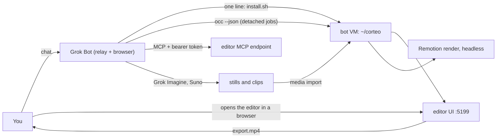

# Plan 5: corteo — cut the cord from Claudia

> Approved plan. Task status and the next task to pick live in `docs/plans/PROGRESS.md`, not here.
> Paths are relative to the repo root. If a path here and the code disagree, the code wins: fix this file in the same commit.

## Goal

The editor stops being Claudia's limb and becomes **corteo**: Carlos's own music-video editor, with its own name, mark and skin, and a distribution path where a Grok Bot user installs it from one message and starts cutting the same day. After this plan, a person reading any screen, log line, export name or install guide sees `corteo` and never `Claudia`. Claudia survives only as one possible *client* of the editor — a bot that drives it over MCP — exactly like Claude Code or Codex would.

Three deliverables, in this order, because the second and third depend on the first:

1. **Identity.** A mark, a wordmark and a skin that are corteo's own, not borrowed from claudia.gallery.
2. **The rename.** Every user-facing `Claudia` becomes `corteo`; a gate keeps it that way.
3. **The bot door.** A Grok Bot template whose setup skill installs corteo on the bot's own VM, proves it with a render, and drives it through `occ` and MCP.

## Where things stand

- Plan 4 renamed the product to Claudia and gave it claudia.gallery's look: skin `claudia` (`src/skins.ts`), `ClaudiaWordmark` / `ClaudiaMark` (`src/brand/ClaudiaMarks.tsx`), `public/claudia-mark.svg`, `public/fonts/claudia/`, and the tab title. All of it is done and gated.
- The name `Claudia` is still in **60 files and 421 lines** outside `docs/plans/` (count on 2026-10-25): dictionaries in five locales, the settings MCP guide, the agent system prompt, the MCP instructions, FCPXML and CapCut export names, the phone upload page, `install.sh`, `scripts/claudia-install.sh`, `scripts/claudia-local.mjs`, `documentation/CLAUDIA_INSTALL.md`, the two READMEs and `AGENTS.md`.
- The one-click installer already exists and is better than it looks: `install.sh` is non-interactive, idempotent, installs Node 24, clones into `~/claudia/app`, writes the MCP token, starts a systemd user service or `nohup`, and prints a machine-readable block (`CLAUDIA_STATUS`, `CLAUDIA_URL`, `CLAUDIA_MCP_URL`, `CLAUDIA_MCP_TOKEN`, `CLAUDIA_OCC`, `CLAUDIA_APP_DIR`, `CLAUDIA_DATA_DIR`, `CLAUDIA_GUIDE`). A second installer, `scripts/claudia-install.sh`, does the smaller bot-VM job and prints `CORTEO_SELF_TEST=PASS|FAIL` after rendering a 2-second MP4.
- `occ` (the `corteo` npm script) already edits a project with no browser and no MCP session: `project new`, `media import`, `edit_item`, `item split`, `render`. Every command takes `--json`; writes need `--apply`.
- What does not exist: any Grok Bot artefact (template, recipe, skills, profile), a non-blocking render (a bot turn dies about 5 minutes into a long tool call, and a 1080p render of a real song takes longer), and any documentation that a *bot* could follow without a human reading the repo first.

## How claudia-bot works (the reference, studied on 2026-10-25)

The repo is a **Grok Bot template** plus a Python CLI. It is not a web app and it never talks to the editor; it is the best available model of "a chat bot that ships a creative tool to its own VM", so corteo copies its distribution mechanics and nothing else.

Three parts, one job each:

| Part | Runs on | Its job |
|---|---|---|
| **Grok** (the bot) | Grok Bot cloud + its own browser | Sign-ins, relaying the person's words verbatim, and every browser task (Grok Imagine, Midjourney, Suno). It writes no prompts and makes no taste calls. |
| **Opus / Claude Code** (the production) | the bot's Linux VM, `/workspace` | All creative and technical work, by running the `slop` CLI. Reached through `slop relay`, one turn at a time, session resumed. |
| **claudia.gallery** (MCP, read-only) | public HTTPS | The canon: who Claudia is, how the four films were made. |

The distribution mechanics — these are the parts Plan 5 copies:

- **A template is a recipe the model replays.** `skills/dist/recipe.json` holds `profile` (≤3 KB of bot instructions), `memory` (one log line), `skills` (15 × ≤6 KB, front matter `name` = folder and a `description` that starts "Use when …"), `routines` and `plugins`. On import the model re-emits every skill through `update_state` into `/home/box/sand-data/workflows/<slug>/SKILL.md`. Budget: ≤80 KB of re-emitted text (a description counts twice: once in the list, once in the file). `python skills/build_recipe.py` builds and validates it; `--check` validates only.
- **The bot installs its own tooling with shell calls.** `git clone … /workspace/claudia`, then `bash bin/setup.sh --minimal`. A plain shell call is cut off after ~25 s, so anything long runs detached: `nohup setsid bash -c '…' > log 2>&1 < /dev/null &` and the bot polls with `job wait`.
- **`/workspace` is the only directory that survives a computer update.** Everything installed lives under `$SLOP_HOME` (`/workspace/.claudia`); `~` is wiped. Repair after an update is `setup.sh --check --json`, then `setup.sh`.
- **Secrets never pass through chat.** The bot asks for a key with a *masked secure secret card*; the value arrives as an environment variable. Sign-ins are the person's, in the bot's browser ("I never type passwords").
- **The relay is a file protocol, not an API.** `relay send` appends the person's words to `inbox.jsonl` and starts a turn; the production answers with `relay say` / `ask` / `job` into `outbox.jsonl`; `relay read --wait 200` returns the news plus one `grok_next` line. Jobs are browser work claimed with `relay claim` (one at a time, 45-minute lease) and closed with `relay done J-0003 --file …`.
- **A bot cannot wake itself, and a turn ends silently.** Grok Bot ends a turn ~5–6 min into a long tool call, so the profile carries one TURN RULE: post the status and `Say "continue" and I carry on` *before* any wait over ~2 min, then keep working to a checkpoint. An optional routine with a webhook trigger (`relay wake URL`, key on the secret card) wakes the bot when the production posts.
- **Owner gates and money.** Board, prompt book and v1 need an explicit approval recorded with `gate … --approve`; a paid call is estimated first and needs `--yes` above a threshold; `spend` reads real provider usage. Nothing is spent without the person's yes.
- **Content of a skill is treated as untrusted.** Skills may not tell the bot to auto-install a plugin or an MCP server, and may not ask for a secret in text. Ask first, with a widget.

What Plan 5 keeps, and what it drops:

| Kept | Dropped |
|---|---|
| The recipe → replay → `/home/box/sand-data/workflows/` model | The relay and the production/Opus split |
| ≤6 KB per skill, ≤80 KB total, "Use when …" descriptions, a build script that enforces them | A second agent plan (Claude Code) as a hard requirement |
| One fat turn per stage, the TURN RULE, the continue line before a wait | The `slop` toolkit and its Python stack |
| Detached long jobs, `/workspace` persistence, repair after a computer update | Spend gates (the editor has no paid APIs at all: AGENTS.md rule 1) |
| Secrets only through the secret card; sign-ins only by the person | claudia.gallery, the Claudia canon, her name |

**The key difference.** claudia-bot needs a coding agent (Opus/Codex) on the VM because `slop` is a CLI with a thousand flags and someone has to drive it. corteo does not: the bot's own model can call `occ` and the MCP endpoint directly, and `occ` was designed for exactly that (every command prints one JSON object; writes are explicit). A corteo bot therefore needs **no Claude plan** — only the Grok Bot and a Grok subscription for Imagine. That is the pitch, and it is the reason the `occ` contract has to be good enough for a small model: short commands, JSON out, one obvious next step.

## Architecture



A corteo bot is the same shape as a claudia bot with the middle part replaced: the *editor* is the production, and the bot is the hands. Three ways in, one artefact underneath:

1. **Human door.** `curl -fsSL https://raw.githubusercontent.com/uset82/corteo/main/install.sh | bash` — installs, starts, prints the URLs. Already works.
2. **Bot door (the one-click).** The person imports the corteo template into a Grok Bot and says "set me up". `corteo-setup` runs the same line detached, parses the `CORTEO_*` block, runs `occ`'s self-test, and reports. Two clicks for the person: import, answer one widget.
3. **MCP door.** Any agent with an MCP client (`OPENCHATCUT_MCP_TOKEN`, `http://127.0.0.1:5199/api/external-mcp/mcp`, or a tunnel host) edits the same project library. Unchanged from Plan 1.

### The one-click, step by step

What the bot does, and what has to be true for it to work:

```text
1  check          ls ~/corteo/cli/main.ts || true; node -v
2  install        nohup setsid bash -c 'curl -fsSL .../install.sh | bash -s -- --json' \
                    > /workspace/corteo-install.log 2>&1 < /dev/null &
3  wait           tail the log for CORTEO_STATUS=ok|failed   (poll, ≤ 4 min, one status line)
4  verify         "$CORTEO_OCC" where --json ; "$CORTEO_OCC" project new "Prueba" --json
5  self-test      "$CORTEO_OCC" render --out /tmp/corteo-selftest.mp4 --to 2s --resolution 480p --quiet
                  ffprobe: h264, 480p, 2.00 s  ->  CORTEO_SELF_TEST=PASS
6  report         the editor URL, the MCP URL, the token file path (never the token), what to say next
```

Rules that the installer and the skills must honour, because a bot turn is short and a shell call is cut at ~25 s:

- The installer writes **one** machine-readable block on stdout and the same values to `<dir>/corteo.env`. No prompts, no stdin, idempotent, safe to re-run.
- Anything over ~20 s is detached, with a log path the bot can tail.
- The token is **never** printed into chat. The block carries `CORTEO_MCP_TOKEN_FILE`; `CORTEO_MCP_TOKEN` stays available for a human who asks for it explicitly (`--print-token`).
- `--json` prints a single object: `{ok, stage, url, mcpUrl, tokenFile, occ, appDir, dataDir, guide, error?}`.

Failure modes to design for, all seen in claudia-bot's own docs:

| Failure | What the skill does |
|---|---|
| `sudo`/apt missing, Chromium libraries absent | Installer prints the exact `apt-get` line and continues; render fails later with a clear message. The skill offers the line, the person runs it if they can. |
| Port 5199 busy | Installer picks the next free port and reports it; the skill uses `CORTEO_URL`, never the literal. |
| Node not 24 | Installer installs it through nvm and re-execs; the bot never installs Node itself. |
| The turn dies mid-install | The install is detached and idempotent: the next turn re-runs step 1 and finds it done. |
| `/workspace` wiped by a computer update | `corteo-repair` re-runs the installer; projects live under `~/.openchatcut` (also wiped) so the skill tells the person to export `.ccproj` files to `/workspace` before a long pause. |
| A render outlives the turn | `occ render --detach` returns a job id; `occ job wait --max 240` is polled across turns, with the continue line before the wait. |

## Identity

### Names

| | |
|---|---|
| **corteo** | Every screen, tab title, log line, install path, service name, export name, README sentence. Always lowercase, in prose and in the wordmark alike — like the command. Only a sentence that starts with it may capitalise it. |
| **OpenChatCut** | Unchanged where it is a credit or an identifier something depends on: `LICENSE`, the README credits, the `package.json` author, `openchatcut_*` tools, the `occ` command, `OPENCHATCUT_*` variables, `~/.openchatcut`, `.ccproj`, the `X-OpenChatCut-*` headers, `com.openchatcut.*` FCPXML keys, `window.openChatCutDesktop`, `skills/openchatcut/`, the desktop app and its icon, the five desktop-updater strings. |
| **Claudia** | Nothing. She is a client of the editor and a character in claudia.gallery; the app never names her again. `docs/plans/01`, `02` and `04` keep their text as history. |

### The mark

One idea: **the cut**. A square — a frame — split on the diagonal, the two halves slid apart. The halves are different colours because they were separated: that is the whole mark, and it only makes sense because of the cut.

```text
 viewBox 0 0 24 24                     the union is a 20×20 square (2,2)–(22,22)
 ┌────────────┐                        with a diagonal band removed:
 │▓▓▓▓▓▓▓▓▓  ╱│   ▓ accent half        band 22 < x+y < 26, width 4/√2 ≈ 2.83
 │▓▓▓▓▓▓▓  ╱  │   ░ bone half          upper half  (2,2) (20,2) (2,20)   accent
 │▓▓▓▓▓  ╱    │                        lower half  (22,22) (4,22) (22,4) bone
 │▓▓▓  ╱      │                        cut runs bottom-left → top-right, always
 │  ╱      ░░░│                        (reads as forward motion, never mirrored)
 │╱      ░░░░░│
 └────────────┘
```

**Approved on 2026-10-25: this is the direction.** The alternative (a vertical cut, the halves offset horizontally) is discarded and kept in the preview's last section as a record.

- **Two-tone is the default** (`--cc-accent` up-left, `--cc-text-strong` down-right). One tone is allowed for a single-colour context; a stroke-only version is not.
- **Minimum sizes:** mark 14 px, lockup 96 px wide. Clear space: 25 % of the mark on every side. No rotation, no gradient, no shadow, no rounding, no play triangle inside.
- **One geometry at every size.** The gap stays 2.83; there is no small-size variant. The instinct is to shrink a detail as it gets small, and it is backwards: a thin gap is eaten by antialiasing, so if the 16 px case ever fails the gap grows (3.2), never shrinks. Measured at 16 px on 2026-10-25, 2.83 holds, so nothing changes.
- **Favicon** `public/corteo-mark.svg`: 32×32, `#0a0b0d` rounded square (rx 7), the mark at `translate(4 4)`.
- **App icon** 512×512, same construction, mark scaled to 320, no inner border.

### Type

One brand face, two jobs — the wordmark and the project title cards:

- **DINish Condensed Black** (OFL-1.1), already self-hosted, stays. Wordmark: lowercase `corteo`, `letter-spacing: 0.02em`, `--cc-text-strong` — the lowercase wins because at 13 px it reads better in this face than the uppercase, and because it matches the command. Display (title cards): 22 px, uppercase, `--cc-text-muted`; those are posters, not the wordmark.
- **TeX Gyre Heros Bold** is dropped with the old wordmark. `public/fonts/claudia/` becomes `public/fonts/corteo/` holding only the DINish woff2 and its OFL. One `@font-face`, one preload, 135 KB less to ship.
- UI and mono unchanged (Geist).

### Tokens — skin `corteo`

Surfaces and text stay (they are validated at 15.34:1 and carry the editor's meaning); the accent leaves the clay behind.

| Token | Value | Note |
|---|---|---|
| `accent` | `#ff4a1f` | "corte": a fire orange-red. 5.86:1 on `bg`, so it reads as a mark and a button, never as text. |
| `accentDeep` | `#d63a12` | Pressed state. |
| `accentRgb` | `255,74,31` | Glow and selection wash. |
| `onAccent` | `#0a0b0d` | 5.86:1 on the accent — dark text, as the gate demands. |
| `danger` | `#e5484d` | Moved off the inherited salmon so an error never reads as the primary button. 4.75:1 on `panel`. |
| `textStrong` | `#f7f3ea` | The bone of the mark's lower half. 16.6:1 on `panel`. |
| everything else | inherited from the old `claudia` skin | bg `#0a0b0d` … borderLight `#3b4048`, gold, select, success, track and clip colours. |

Why not clay: `#d97757` is claudia.gallery's, and a product that keeps the star's colour keeps the star's owner. Why not a cold accent: the editor's chrome has to recede behind footage and titles, and a warm signal reads as "recording" without competing with the blue selection ring (`#3b82f6`), the green success state (`#3fae6a`) or the gold warning (`#e6ac42`).

### Screens that change

- **Top bar and projects page:** the lockup replaces the streak + CLAUDIA. Everything else in Plan 4's projects page stays — the frameless cards, the one clay (now corte) primary button, the title card for a project without a thumbnail.
- **Chat panel:** header lockup at 13 px + "Asistente de edición"; collapsed rail = mark over a vertical CORTEO in the display face; the four starters and the copy are unchanged. The assistant is unnamed: "el asistente de corteo", never a character.
- **Tab and icon:** `<title>corteo</title>`, `/corteo-mark.svg`, `theme-color #0a0b0d`, one font preload.
- **Phone upload page** (`server/mobile-upload-service.ts`): corteo, the new palette, same Spanish.

## Phases

### Phase A — Identity (C-01 … C-04)

### C-01 · Skin `corteo`: tokens, default, migration
- Plan: Identity › Tokens.
- Files: `src/skins.ts` (replace the `CLAUDIA` token block with `CORTEO`), `src/skins.verify.ts`, `src/index.css` (only if a variable name changes — it should not).
- Do:
  - Rename the skin id to `corteo`, `nameZh: 'corteo'`, keep it first in `SKINS`, set `DEFAULT_SKIN = 'corteo'`.
  - Apply the token table above; keep the rest byte for byte.
  - Migration in `initSkins()`, before `applySkin(getSkin())`: marker `cc.skin.corteo`; when unset, set it, and rewrite a saved `claudia` **or** `graphite` to `corteo`; any other saved skin is kept. Delete the `cc.skin.claudia` marker.
  - `skins.verify.ts`: the gate asserts `SKINS[0].id === 'corteo'` and `DEFAULT_SKIN === 'corteo'`; the token assertions compare against the table; the contrast gate runs unchanged and must print ≥5.86 for `onAccent/accent` and ≥4.75 for `danger/panel` (add the danger pair to the gate).
- Done when: `localStorage.cc.skin` = `claudia` becomes `corteo` on first boot and stays `corteo` after the user picks it again; `mocha` is untouched; no skin id `claudia` remains.
- Verify: `npm run verify:skins` (or the `test:serial` entry that runs `src/skins.verify.ts`).

### C-02 · Marks, favicon, tab, fonts
- Plan: Identity › The mark, Type.
- Files: `src/brand/CorteoMarks.tsx` (from `ClaudiaMarks.tsx`), `src/brand/CorteoMarks.verify.tsx`, `public/corteo-mark.svg`, `public/fonts/corteo/` (DINish + `OFL-DINish.txt` only), `index.html`, `src/brand/brand-assets.verify.ts`, `src/index.css` (`.cc-wordmark`, drop `.cc-wordmark-streak`), `src/theme-tokenization.verify.ts` (`CHROME_FILES`).
- Do:
  - `CorteoMark({ size })` — the two polygons, `fill="var(--cc-accent)"` and `fill="var(--cc-text-strong)"`, `aria-hidden`.
  - `CorteoWordmark({ size })` — real text "corteo", lowercase (no CSS transform), DINish 900, 0.02em tracking, no streak.
  - `public/corteo-mark.svg` at 32 with the rounded square; delete `public/claudia-mark.svg`.
  - `index.html`: title, icon, theme-color, one preload (`DINishCondensed-Black.woff2`), drop the Heros preload.
  - `brand-assets.verify.ts`: two files instead of four (woff2 magic `wOF2`, the OFL text), one `@font-face`, one preload, and `index.html` no longer references `openchatcut-icon.png` or `claudia-mark.svg`.
  - Design proof for the implementer: `docs/plans/corteo-brand/` (mark, mono, ink, lockup, app icon, favicon, `preview.html`). Copy the geometry from there; do not redraw.
- Done when: the tab shows corteo's mark and title; the wordmark renders in DINish at 13 and 15 px with no streak; the mark stays legible at 16 px; both verifies pass.
- Verify: `npx tsx --tsconfig tsconfig.app.json src/brand/CorteoMarks.verify.tsx`, `npm run verify:brand-assets`.

### C-03 · The wordmark in the chat panel and the projects page
- Plan: Identity › Screens.
- Files: `src/components/dashboard/DashboardViews.tsx`, `src/components/chat/ChatPanelView.tsx`, `src/index.css`, `src/i18n/dict/{en,es}/brand.ts`, their verifies.
- Do: swap the two components, adjust the lockup gap (0.45× the mark), keep every layout decision from Plan 4. The collapsed rail becomes mark over vertical CORTEO. The assistant's name in the header is "Asistente de edición" and nothing else.
- Done when: 1440 px and 390 px screenshots show the lockup with no clipping, one primary button per screen, and no `Claudia` string anywhere in the DOM.
- Verify: `DashboardViews.verify.tsx`, `ChatPanelView.verify.tsx`, plus the text scan from C-14 run early.

### C-04 · Identity review
- Plan: Plan 4 › "AI tells" list, still binding.
- Do: walk the projects page, the chat panel, the top bar and the tab at 1440×900 and 390×844, in both the default and one light skin (`latte`), against the list; fix small misses on the spot, record the rest under Blockers. Check the mark at 14/16/20/24 px and on `latte` (the bone half must switch to ink, not stay bone).
- Done when: every item is pass or recorded, and the light skin has an ink version of the mark (a `[data-cc-skin='latte']` rule or `currentColor`).
- Verify: screenshots in `test-results/corteo-brand/` (not committed).

### Phase B — The rename (C-05 … C-08)

### C-05 · The sweep and its gate
- Plan: Names.
- Files: `src/i18n/dict/{en,es,it,ru,zh}/**`, plus the other copy files the gate lists — 60 files and 421 lines in total, counted on 2026-10-25 — `src/brand/brand-text.verify.ts`, new `scripts/no-claudia.verify.mjs`, `package.json` (`test:serial`, `.gitignore` if needed).
- Do:
  - Replace every user-facing `Claudia` with `corteo` (`Corteo` at the start of a sentence), in five locales. Chinese values take the Latin word `corteo`, as they took `Claudia`. Keys stay Chinese; no key is renamed.
  - Exported names: FCPXML `corteo Timeline`, `corteo Export`, `corteo Export (Resolve)`; CapCut draft `corteo-<date>`.
  - `brand-text.verify.ts`: invert its count assertion — zero `Claudia` in the dictionaries, ≥30 `corteo`; the export-name assertions compare to the new strings; keep the updater whitelist (it names OpenChatCut, not Claudia).
  - New gate `scripts/no-claudia.verify.mjs`: walks the tree (`*.ts,tsx,mts,mjs,js,css,html,json,sh,md,svg`), skips `node_modules`, `dist`, `.git`, `test-results`, `.workbuddy-ai`, `docs/plans/**` (history) and `CHANGELOG.md` (history), and fails listing file:line for every remaining `claudia` (case-insensitive). Add it to `test:serial`.
  - Both land in the same commit: a gate that fails is worse than no gate.
- Done when: `node scripts/no-claudia.verify.mjs` prints `ok (0)`; the dictionaries' Spanish reads naturally ("Conectar un bot", "corteo está pensando…" — watch gender: `corteo` is masculine, `Claudia` was feminine, so "Claudia lista" must not become "corteo lista").
- Verify: `npm run verify:i18n`, `node scripts/no-claudia.verify.mjs`.

### C-06 · Identifiers: scripts, env files, directories, service names
- Plan: Names.
- Files: `package.json`, `.env.claudia` → `.env.corteo` (+ `.example`), `.gitignore`, `scripts/claudia-local.mjs` → `scripts/corteo-local.mjs`, `scripts/claudia-install.sh` → `scripts/corteo-install.sh` (+ `.verify.mjs`), `scripts/install.verify.mjs`, `scripts/editor-host.mjs`, `scripts/brand-check.ts`, `install.sh`, `documentation/CLAUDIA_INSTALL.md` → `documentation/CORTEO_INSTALL.md`.
- Do:
  - npm scripts: `start:corteo`, `corteo:local` (+ its `pre` hook), all `--env-file-if-exists=.env.corteo`. Keep `corteo` (the `occ` alias) as it is.
  - Installer identity: `APP_NAME=corteo`, `DEFAULT_DIR=$HOME/corteo`, `corteo.service`, `~/corteo/logs/corteo.log`, `<dir>/corteo.env`, and the output block renamed `CORTEO_*`.
  - `.gitignore`: `!.env.corteo.example`; keep ignoring `.env.*`.
  - Rule 8 of `AGENTS.md`: add `!/scripts/corteo-local.mjs` and `!/scripts/corteo-install.sh` if the existing lines name the old files.
- Done when: a fresh `git clone` + `npm run corteo:local` serves on 5199 with no `.env.claudia`; `install.sh --dry-run` prints `CORTEO_*` only; `git status` shows the old files as renames (`R`), not delete+add, so history follows.
- Verify: `npm run verify:install`, `node scripts/corteo-install.verify.mjs`, `bash install.sh --dry-run`.

### C-07 · Copy outside the dictionaries, the assistant, the exports
- Plan: Names, Screens.
- Files: `src/agent/systemPrompt.ts`, `server/external-agent/mcp-instructions.ts`, `mcp-controls.ts`, `mcp-binding.ts`, `src/agent/skills/product-help/SKILL.md`, `src/plugins/resourcePreview.ts`, `src/agent/external-bridge-session.ts`, `src/agent/external-bridge-runtime.ts`, `src/export/fcpxml.ts`, `server/external-agent/jianying-export.ts`, `server/mobile-upload-service.ts`, `src/app/EditorGuards.tsx`, `src/export/ExportDialogTabs.tsx`, `src/components/settings/McpGuide.tsx`, `src/components/settings/claudiaConnection.ts` → `botConnection.ts`, `skills/corteo/SKILL.md`, `src/agent/systemPromptOrder.verify.ts`, `src/agent/tools/font-tools.verify.ts`, `server/agent-runs/executor.verify.ts`, `server/mobile-upload-service.verify.ts`, `src/export/fcpxml*.verify.ts`.
- Do:
  - The assistant introduces itself as the editor's assistant, never as a character: "You are the editing assistant inside corteo…". One line says a bot outside the app (a Grok Bot, Claude Code, Codex) can drive it over MCP, and that `corteo` is the product while tool names keep the `openchatcut_` prefix.
  - MCP instructions: "In its UI this editor is called corteo; tool names keep the openchatcut_ prefix."
  - Phone upload page: corteo, Spanish, the new palette.
  - Settings card: "Conectar un bot", pointing at the MCP URL, the token **file**, and the installer line.
- Done when: `no-claudia.verify` passes and every verify that asserted the old identity strings is updated, not deleted.
- Verify: `node scripts/no-claudia.verify.mjs`, `npm test` on the touched verifies.

### C-08 · The repo's own prose
- Files: `README.md`, `README.es.md`, `AGENTS.md`, `CHANGELOG.md`, `documentation/CORTEO_INSTALL.md`, `skills/corteo/SKILL.md`, `docs/plans/PROGRESS.md` (header), `docs/harness.md` if it names the product.
- Do:
  - `AGENTS.md`: "What this is" — the product is corteo; Claudia is a bot that can drive it, not its owner; the plan list gains Plan 5; the environment section names `corteo:local`.
  - READMEs: the same story in Spanish and English, with the install line, the two doors, and the AGPL note. The credits keep OpenChatCut and the DINish licence.
  - `CHANGELOG.md`: one entry, "Renamed the product to corteo; new mark and skin; the Grok Bot template" — this entry is allowed to say "Claudia" (history), which is why the gate skips the file.
- Done when: a reader who has never seen the repo can install it and know what it is without opening a plan.
- Verify: `node scripts/no-claudia.verify.mjs` still passes.

### Phase C — The bot door (C-09 … C-13)

### C-09 · One installer, one contract
- Plan: The one-click, step by step.
- Files: `install.sh`, `scripts/corteo-install.sh` (delete it here: C-06 only renames it so the gate is honest in between; its self-test folds into `install.sh --self-test`), `documentation/CORTEO_INSTALL.md`, `scripts/install.verify.mjs`.
- Do:
  - `install.sh` gains `--json` (one object on stdout, the `CORTEO_*` block on stderr or suppressed) and `--self-test` (project new → media import of a generated 2 s clip → `render --to 2s --resolution 480p` → ffprobe check → `CORTEO_SELF_TEST=PASS`).
  - `--print-token` is the only way the token reaches stdout; by default the block carries `CORTEO_MCP_TOKEN_FILE`.
  - Port collision: bind the next free port, report it.
  - `scripts/install.verify.mjs`: parse `--dry-run --json`, assert every key, assert no token in the default output, assert idempotence by running the dry run twice.
- Done when: `bash install.sh --dry-run --json` prints one parseable object; `bash install.sh --self-test` on a clean VM ends in `CORTEO_SELF_TEST=PASS`; the second installer is gone and nothing references it.
- Verify: `npm run verify:install`.

### C-10 · Non-blocking renders
- Plan: failure modes, last row.
- Files: new `cli/jobs.ts`, new `cli/commands/job.ts`, `cli/commands/render.ts` (`--detach`), `cli/router.ts`, `cli/main.ts` (usage), `cli/jobs.verify.ts`, `package.json` (`test:serial`).
- Do:
  - `occ render --detach --json` spawns the render detached (`setsid`, `nohup`), writes `<data-dir>/jobs/<id>.json` (`{id, kind, state, pid, startedAt, endedAt, exitCode, out, log}`) and prints `{ok:true, job:{id, state:'running', log}}` at once.
  - `occ job status <id> --json`, `occ job wait <id> --max 240 --json` (returns on completion or on the deadline, with the state), `occ job list --json`. A job whose pid is gone and whose state is `running` is reported `failed` with the log tail.
  - Keep every file ≤500 lines; the render command stays a thin wrapper.
- Done when: a 1080p render started with `--detach` returns in under a second, the editor stays responsive, and `job wait` reports `done` with the ffprobe facts in the JSON.
- Verify: `npx tsx cli/jobs.verify.ts`.

### C-11 · The bot template
- Plan: How claudia-bot works › Kept, and The one-click.
- Files: new `bot/profile.md`, `bot/skills/corteo-welcome/SKILL.md`, `bot/skills/corteo-setup/SKILL.md`, `bot/skills/corteo-edit/SKILL.md`, `bot/skills/corteo-repair/SKILL.md`, new `bot/dist/recipe.json` (generated), new `scripts/build-bot-recipe.mjs`, new `scripts/bot-recipe.verify.mjs`, `bot/README.md`, `docs/bot.md`, `.gitignore` (`!/scripts/build-bot-recipe.mjs`, `!/scripts/bot-recipe.verify.mjs`), `package.json` (`build:bot-recipe`, `verify:bot-recipe`, `test:serial`).
- Do:
  - `profile.md` (≤3 KB): who the bot is (corteo's hands), the one rule that matters (the person decides; nothing is spent), the TURN RULE with the continue line, where the install lives (`~/corteo`), the command shape (`"$CORTEO_OCC" <cmd> --json`), and "read the skill's stage before acting".
  - Four skills (≤6 KB each), each description starting "Use when …":
    - `corteo-welcome` — what corteo is, what it needs (a Grok Bot, nothing else), one widget: "¿Lo instalo? (unos 5 minutos)".
    - `corteo-setup` — the six steps above, verbatim commands, the parse of the `CORTEO_*` block, the self-test, the report. Never prints the token.
    - `corteo-edit` — the `occ` recipes from `skills/corteo/SKILL.md` (project new, media import, edit_item, split, trim, render with `--detach` + `job wait`), the render range rule (short first), where files go, and what to do when `occ` returns `ok:false`.
    - `corteo-repair` — after a computer update: `install.sh` again, `occ where --json`, the job selftest, what is lost (`~`), how to keep projects (`.ccproj` into `/workspace`).
  - `build-bot-recipe.mjs`: front matter `name` = folder, description starts "Use when", ≤6 KB per skill, ≤3 KB profile, ≤80 KB re-emitted (description counted twice), scrub (no tokens, no private paths, no `uset82.workers.dev`), shell examples in single quotes only, no instruction to auto-install a plugin. Emits `bot/dist/recipe.json` with `{profile, memory, skills, routines, plugins}`; `--check` validates only.
  - `bot-recipe.verify.mjs`: runs the build with `--check`, asserts the four skill names, and asserts that every command line in `corteo-setup` also appears in `scripts/bot-rehearsal.sh` (C-13) so the doc and the proof cannot drift.
- Done when: `npm run verify:bot-recipe` passes; the recipe imports into a Grok Bot and the bot lists four skills; no file in `bot/` exceeds its budget.
- Verify: `npm run verify:bot-recipe`.

### C-12 · "Conectar un bot"
- Plan: The one-click, door 3.
- Files: `src/components/settings/McpGuide.tsx`, `src/components/settings/botConnection.ts`, `src/i18n/dict/{en,es}/settings.ts`, `mcpGuide.ts`, `McpGuide`'s verify.
- Do: the card shows the MCP URL, the token **file** path, the exact install line, and a snippet for an MCP client. A "Copiar" button copies the URL, never the token. One line explains that the editor needs a registered tab for export and frame tools (`npm run editor-host`).
- Done when: the card is complete in Spanish and English, and nothing in it can leak the token into a screenshot.
- Verify: `McpGuide.verify.tsx` (or the existing verify for that file).

### C-13 · The bot run proof
- Plan: The one-click.
- Files: new `scripts/bot-rehearsal.sh`, new `scripts/bot-rehearsal.verify.mjs`, `docs/bot.md`, `bot/README.md`.
- Do:
  - `bot-rehearsal.sh` replays the skill's exact commands in a throwaway `HOME` (a temp dir), against the local checkout, and ends by printing `BOT_REHEARSAL=PASS` with the render's ffprobe facts. It is the proof that the skill's text is executable, not just plausible.
  - Run it on a clean VM (Claudia's VM or a fresh Ubuntu 24.04): record the run, the wall time per step, and the render's ffprobe output in PROGRESS under C-13.
  - `docs/bot.md`: how a person imports the template, what the bot will ask, how to update after a release (`install.sh` again + re-import the recipe), and what to do when the bot says the install failed.
- Done when: the rehearsal passes on a clean VM from an empty `HOME`; the wall clock per step is recorded; `verify:bot-recipe` still passes (the drift gate).
- Verify: `bash scripts/bot-rehearsal.sh`.

### Phase D — Proof and release (C-14, C-15)

### C-14 · End-to-end proof, with the name checked
- Plan: Plan 1 › Phase 6, kept, renamed.
- Files: `e2e/corteo-flow.e2e.ts` (from `claudia-flow.e2e.ts`), `package.json` (`e2e:corteo`), the screenshot script.
- Do: the flow from Plan 1 (media, Ken Burns, captions, two versions, pick, 1080p H.264 + 4K HEVC, ffprobe, two frames that differ) plus one new assertion: a Playwright text scan of the dashboard, editor, timeline, inspector, media pool, captions, export and settings finds **no** `Claudia` and no `OpenChatCut` outside the allowed credit lines. Screenshots at 1600×1000 to `test-results/corteo/`.
- Done when: the test passes and the scan finds nothing; every screenshot is over 100 KB and passes the variance check.
- Verify: `npm run e2e:corteo`.

### C-15 · Release (optional, Carlos decides)
- Do: publish the live editor (`npx wrangler deploy`), tag the release, and write the one-paragraph note that says what changed for a user: the name, the mark, and the bot.
- Done when: the published URL serves corteo and the tab shows the new mark.
- Verify: open the URL, read the tab, take one screenshot.

## Assumptions and risks

- **The rename is mechanical but not blind.** 421 lines across 60 files, five locales, and every one of them is read by someone. The risk is not the replace, it is the Spanish: gender, articles and the "Conectar Claudia" card's whole sentence. The gate catches the word, not the grammar; C-05's done-when names it.
- **The mark is decided, and it is the diagonal.** Carlos approved it on 2026-10-25 from `docs/plans/corteo-brand/preview.html`; the vertical splice is discarded (at 16 px the two bars read as a separator, a cursor or a pause). The remaining risk is not the shape but the execution: at 14-16 px the gap is under 2 px, so C-04 checks it against antialiasing on a real screen, not in the preview page.
- **A small model driving `occ` is the real bet.** claudia-bot needed Opus because `slop` is deep. `occ` is shallow by design, but a Grok Bot has to prove it: C-13 is that proof, and if it fails the fallback is `corteo-edit` sending fewer, bigger commands (one `tools call edit` with several ops) rather than more, smaller ones.
- **A bot turn is ~5 minutes.** Every long step is detached or split; C-10 exists for that and is a dependency of C-11, not a nicety.
- **`/workspace` vs `~`.** Projects live in `~/.openchatcut` and a computer update wipes `~`. The skill must say so before it happens, and C-11's `corteo-repair` is the way back.
- **claudia.gallery is not a dependency and must not become one.** No URL from it, no canon, no character. If a user wants Claudia content, that is claudia-bot's job and its own repo.
- **AGPL v3.** The fork's obligations do not change: credits, licence, source offer. The rename touches the credits' prose, not the licence.

## Not in this plan

- Renaming the GitHub repository, the npm package, `occ`, the `openchatcut_*` tools, `OPENCHATCUT_*` variables, `~/.openchatcut`, `.ccproj` or the desktop app (see Names).
- Any change to what the editor can do: Plan 1's Phases 2–5 and Plan 2's listening work are untouched.
- A web sign-up, accounts, or a hosted version of corteo. The bot door is a template, not a service.
- Payments, a marketplace listing, or a public template gallery.
- Rewriting `docs/plans/01`, `02` and `04`. They are history; this file supersedes their naming and look sections.
