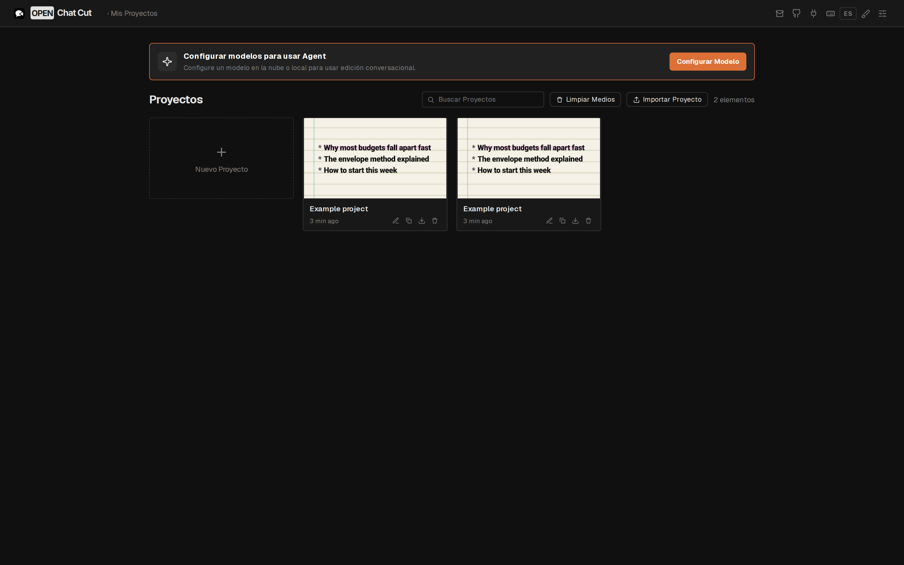

# Guía de usuario — Editor de videoclips

Esta guía cubre el flujo completo para montar un videoclip musical con la interfaz en español. El editor está construido sobre OpenChatCut (AGPL v3) y añade herramientas específicas: Ken Burns, subtítulos karaoke, detección de fragmentos duplicados, doble visualización de tiempo, Monitor de origen y exportación avanzada.

<p align="center">
  
</p>

---

## 1. Inicio rápido

Requisitos: **Node.js 24.x** (el proyecto exige `>=24 <25`) y npm 10+.

```bash
npm install
npm run dev          # http://localhost:5199
```

La interfaz arranca en **español**. El conmutador **ES/EN** de la barra superior cambia el idioma sin recargar. Las funciones de IA son opcionales: la edición, los subtítulos y el renderizado local funcionan sin claves de API. Para usar proveedores en la nube, copia `.env.example` a `.env` y rellena solo los que necesites.

Para generar una versión de producción:

```bash
npm run build
npm run preview
```

---

## 2. La interfaz

| Zona | Función |
| --- | --- |
| Barra superior | Proyecto, idioma ES/EN, deshacer/rehacer, exportar, ajustes |
| Panel de medios (izquierda) | Importar y arrastrar material, buscar, menú contextual |
| Espacio de previsualización (centro) | Monitor de origen arriba y Monitor de programa abajo |
| Inspector (derecha) | Transformación, filtros, color, audio, Ken Burns, efectos |
| Línea de tiempo (abajo) | Pistas de vídeo/audio/subtítulos, herramientas, marcadores, zoom |
| Menú del clip | Transiciones, efectos y LUTs: se aplican desde el menú contextual del clip y se ajustan en el inspector |

Capturas: [`01-editor-overview.png`](../screenshots/01-editor-overview.png) · [`03-full-editor.png`](../screenshots/03-full-editor.png) · [`04-editor-with-panels.png`](../screenshots/04-editor-with-panels.png) · [`dashboard-spanish.png`](../screenshots-spanish/dashboard-spanish.png)

---

## 3. Flujo de trabajo para un videoclip

1. **Importa** los vídeos, la canción y las fotos al panel de medios (arrastrar o botón de importar).
2. **Arrastra** el audio a una pista de audio y los clips de vídeo a las pistas de vídeo.
3. **Ordena** las secciones de la canción (intro, verso, estribillo) cortando con `Mod+K`.
4. **Aplica Ken Burns** a las fotos fijas (ver sección 4).
5. **Añade subtítulos karaoke** desde un archivo `.srt` o `.ass` (ver sección 5).
6. **Corrige el color** con exposición, temperatura o los filtros del inspector.
7. **Añade transiciones** en los cambios de sección arrastrándolas desde la biblioteca.
8. **Exporta** en 1080p H.264 (ver sección 7).

---

## 4. Ken Burns (paneo y zoom sobre fotos)

1. Selecciona un clip de imagen en la línea de tiempo.
2. Abre **Inspector → Efecto Ken Burns** (solo aparece para imágenes).
3. Define posición y escala de **inicio** y **fin**, y elige la curva de suavizado.

El panel crea dos fotogramas clave (inicio y fin del clip) con la misma curva de easing. La geometría se evalúa con valores fraccionarios tanto en la previsualización como en la exportación, así que el movimiento es suave a nivel subpíxel y no produce el temblor típico de FFmpeg. Todo el gesto se deshace con un solo `Mod+Z`.

Consejos:

- Para un zoom lento, usa escala 1.00 → 1.15 y duración de 4–6 segundos.
- Para un desplazamiento lateral, cambia X de 0 a 100 manteniendo la escala.
- Velocidades de exportación disponibles: 24, 25, 30, 50 y 60 fps.

Módulos: `src/editor/kenBurns.ts` y `src/components/inspector/KenBurnsControls.tsx`.

---

## 5. Subtítulos karaoke

Estilos incluidos:

| Estilo | Aspecto |
| --- | --- |
| **Karaoke balada** (`karaoke-verse`) | Georgia serif, blanco, abajo al centro |
| **Karaoke grito** (`karaoke-chant`) | Impact negrita, rojo, centrado, resaltado amarillo |
| **Karaoke relleno** (`karaoke-fill`) | Arial, blanco, abajo, barrido de color |

Pasos:

1. Importa el archivo `.srt` o `.ass` desde el panel de medios. Los tiempos por palabra de ASS (`{\k}`) se conservan.
2. Selecciona el clip de subtítulos y abre el selector de estilo.
3. Elige un estilo del grupo **Karaoke para cantar**.
4. Ajusta los tiempos en el editor visual o en la tabla de palabras.
5. Exporta los subtítulos de nuevo a `.srt` / `.ass` si los necesitas fuera del proyecto.

Los estilos son plantillas de subtítulos normales: la previsualización y la exportación usan el mismo renderizador, así que no hay diferencias entre lo que ves y lo que se graba.

---

## 6. Herramientas profesionales

### Monitor de origen

Haz clic derecho en un vídeo, audio, imagen, GIF o SVG del panel de medios y elige **Abrir en el monitor de origen**.

- Reproduce, pausa y avanza fotograma a fotograma
- Marca **entrada** y **salida** con `I` / `O` o los botones del panel
- El rango se muestra en segundos y se puede restablecer
- **Insertar en la línea de tiempo** coloca exactamente el rango marcado en el playhead y se deshace con un solo paso

### Marcadores

- `M` añade un marcador en el playhead; `Mod+M` lo añade y abre el editor
- `Shift+M` modifica y `Alt+M` elimina el marcador del playhead
- `Shift+↑` / `Shift+↓` saltan entre marcadores
- Ocho colores, notas en línea y lista de marcadores con salto al hacer clic
- Los marcadores de clip son independientes de los del proyecto

### Detección de fragmentos duplicados

Menú **más** de la línea de tiempo → **Detección de Fragmentos Duplicados**. La herramienta muestrea un fotograma del centro de cada clip, calcula un hash perceptual de 64 bits y agrupa los clips por similitud (umbral de Hamming ajustable, 6 por defecto). Al pulsar un grupo se seleccionan todos los clips coincidentes.

### Visualización de tiempo

Haz clic en el código de tiempo de la línea de tiempo para alternar entre **tiempo transcurrido** (`0:00:05.23`) y **cuenta atrás** (`-0:03:54.77`). La preferencia se guarda en el navegador y nunca muestra valores negativos.

### Color

El inspector ofrece **brillo, contraste, saturación y desenfoque**, además de **exposición** y **temperatura**. El ajuste automático analiza localmente una muestra y aplica correcciones pequeñas. Los LUT (`.cube`) se aplican desde el menú contextual del clip seleccionado y se retiran desde el mismo menú o desde la pila de efectos del inspector.

---

## 7. Exportación

| Ajuste | Opciones |
| --- | --- |
| Resolución | 720p (1280×720), 1080p (1920×1080), 4K (3840×2160) |
| Códec | H.264 (libx264), H.265/HEVC (libx265, render en servidor) |
| Calidad | CRF 18–28 o bitrate objetivo (mutuamente excluyentes) |
| Frecuencia | 24 / 25 / 30 / 50 / 60 fps |
| Audio | AAC 192 kbps con compensación del retardo del codificador |
| Contenedor | MP4 con `+faststart` para reproducción progresiva |

El resumen muestra el tamaño estimado antes de exportar. El render usa Remotion; la ruta de servidor añade el pase de retemporización de HEVC y el mux con `-movflags +faststart`. Sin servidor, el navegador exporta con los códecs que soporte.

**Limitaciones conocidas**

- La codificación en 2 pasadas no está implementada: Remotion renderiza en una pasada con CRF o bitrate.
- HEVC requiere el renderizador del servidor; la ruta del navegador lo rechaza.
- No hay inserts de EQ/compresor por clip en la cadena de audio del cliente. La limpieza de voz existe como plugin FFmpeg del servidor (`highpass/lowpass/afftdn/acompressor`), no como efecto en tiempo real.

---

## 8. Atajos de teclado

`Mod` es **Cmd** en macOS y **Ctrl** en Windows/Linux. La lista completa está en **Mod+Alt+K**.

### Reproducción

| Acción | Teclas |
| --- | --- |
| Reproducir / pausar | `Espacio` |
| Fotograma anterior / siguiente | `←` / `→` |
| Retroceder / avanzar 1 s | `Shift+←` / `Shift+→` |
| Reproducción inversa / directa / pausa | `J` / `L` / `K` |
| Ir al inicio / final | `Inicio` / `Fin` |
| Corte anterior / siguiente | `↑` / `↓` |
| Marcar entrada / salida / limpiar | `I` / `O` / `X` |
| Marcar clip en el playhead | `/` |
| Pantalla completa | `` ` `` |

### Edición

| Acción | Teclas |
| --- | --- |
| Deshacer / rehacer | `Mod+Z` / `Mod+Shift+Z` o `Mod+Y` |
| Copiar / cortar / pegar | `Mod+C` / `Mod+X` / `Mod+V` |
| Pegar efectos | `Mod+Alt+V` o `Mod+Shift+B` |
| Duplicar clip | `Mod+D` |
| Dividir en el playhead | `Mod+K` o `Enter` |
| Eliminar y cerrar hueco | `Retroceso` / `Supr` |
| Eliminar dejando hueco | `Shift+Retroceso` / `Shift+Supr` |
| Seleccionar todo | `Mod+A` |
| Seleccionar hacia delante | `Shift+Y` |
| Selección / ripple / deslizar / cuchilla | `V` / `B` / `Y` / `C` |
| Pluma / texto / mano / zoom | `P` / `T` / `H` / `Z` |
| Mover 1 o 5 fotogramas | `E` / `R` (con `Shift`, 5) |
| Recortar al entrada / salida | `Q` / `W` |
| Subir / bajar de pista | `Alt+↑` / `Alt+↓` |
| Guardar versión | `Mod+S` |

### Vista y marcadores

| Acción | Teclas |
| --- | --- |
| Zoom in / out | `Mod+=` / `Mod+-` (o `=` / `-`) |
| Ajustar vista | `Shift+Z` |
| Activar/desactivar imán | `S` |
| Añadir marcador | `M` |
| Añadir marcador y editar | `Mod+M` |
| Modificar / borrar marcador | `Shift+M` / `Alt+M` |
| Marcador anterior / siguiente | `Shift+↑` / `Shift+↓` |
| Ir al chat de IA | `Tab` |

Los atajos respetan el foco: las teclas de edición solo actúan cuando el foco está en la línea de tiempo, mientras que deshacer, rehacer, guardar, ayuda y chat funcionan en cualquier panel.

---

## 9. Problemas frecuentes

| Síntoma | Solución |
| --- | --- |
| `npm install` no ejecuta scripts | npm 11+ los ignora por defecto; revisa la política de scripts del repositorio |
| Versión de Node incorrecta | Usa Node 24 (`nvm use 24`); el proyecto exige `>=24 <25` |
| La exportación falla en Linux/WSL | Instala `libnspr4` y `libnss3`, o apunta `LD_LIBRARY_PATH` a `.local-libs/` |
| Aparece texto en chino | Ejecuta `npm run verify:i18n` y añade la clave en `src/i18n/dict/en/*` y `src/i18n/dict/es/index.ts` |
| El servidor no es accesible desde una VM | `host` y `allowedHosts` ya están configurados en `config/vite.config.ts` |

---

## 10. Licencia

Este proyecto es una modificación de OpenChatCut y se distribuye bajo **AGPL v3**. Consulta [`LICENSE`](../LICENSE) y el [README](../README.md) original.
